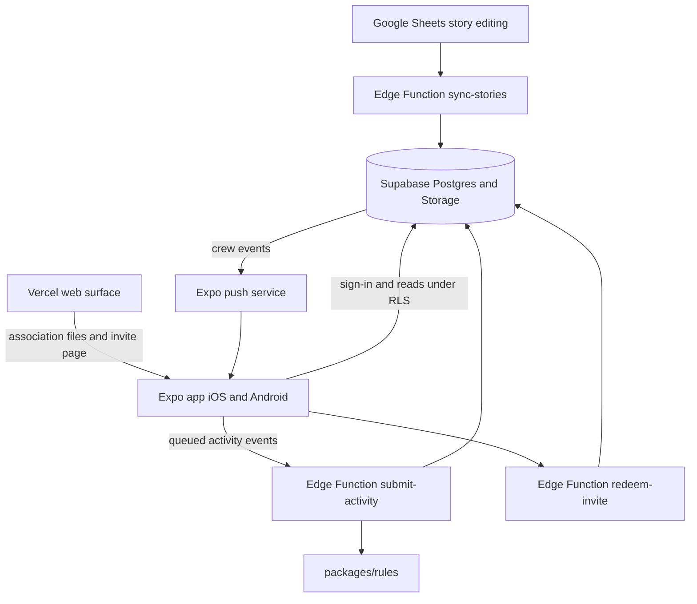
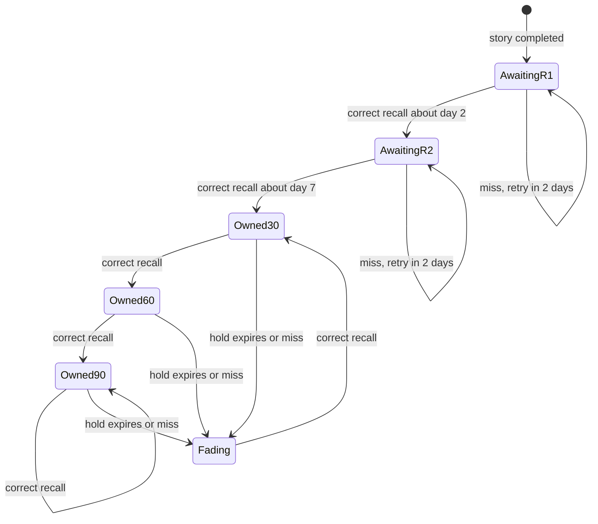
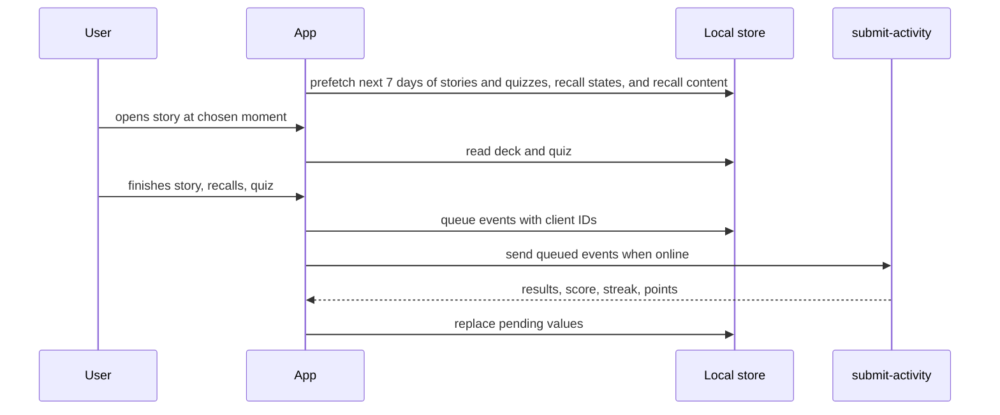
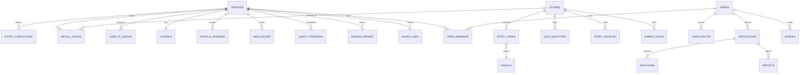

# Make Me Cool v1 - Plan

## Goal Capsule

- **Objective:** A working professional aged 23 or over, whose conversations have gone stale, spends about five minutes on each weekday learning one well-told story that connects two fields, and can then retell it in conversation.
- **Means:** An Expo (React Native) app on Supabase, with Vercel hosting the web surface (KTD1, KTD2, KTD3).
- **Execution profile:** Greenfield, one repository, built in the dependency order shown in the Unit Index (U11 before U10). The Product Contract wins on product behavior; a KTD wins on implementation mechanism.
- **Stop conditions:** Stop and ask if a store policy forces a change to sign-in or age rules, if a story cannot record a visual source and licence, or if the rules engine cannot meet the two-recalls-a-day cap (R12).
- **Product authority:** the founder of The Abstract Room decides product behavior and scope. Surrounding versions (v1.1 onward) are not active scope.
- **Open blockers:** none for planning. The 2-week demand test was skipped by choice, so no evidence yet shows people will return daily (Assumption 1).

## Product Contract

### Direction update, 2026-10-19 (supersedes the requirements named below)

This section records founder decisions made after the plan was written. Where it conflicts with a requirement below, **this section wins**. The full reasoning is in `docs/strategy/` (`00-decision-log.md` and checkpoints 01 to 06). Requirements it replaces are marked `[SUPERSEDED]` or `[DEFERRED]` in place; they are kept for traceability, not deleted.

**Product centre:** retelling. The person can say what they learned out loud, to someone, the same day. Success is "told it", not "completed".

**New and changed requirements**

- R41. **Retell-first.** After the quiz the app asks "who will you tell this to today?" and offers a one-tap share of a human-written retell card. The next day it asks once, "did you tell it? how did it land?" (this replaces the "did you use it?" tap in R16). The answer is a signal, never a reward on its own, and it is never tied to the streak.
- R42. **Curator dispatch.** Every story shows the curator's name and a short note on why it was picked and what could not be confirmed. The founder is the curator for now. The app may claim only what the workflow really does: a story is labelled "checked" only if a named person checked each claim against two sources.
- R43. **Cool score, as a rate.** The cool score is shown over 7, 30, 90 and 365 days: `round(100 × (0.7 × finished_days/N + 0.3 × told_days/N))`. A finished day is a story finished before local midnight of its publish day; a told day is a "yes, I told it" answer. N is the window length minus days with no published story, minus one rest day per rolling 7 days (the "one free miss"), minus days before the user joined; in a user's first week N for the 7-day window is never below 7. The 30, 90 and 365-day windows unlock once the user has been around that long. The score may fall, but copy never says "you lost". The user can hide it. A "how is this calculated?" link is always available. Weights are hypotheses to calibrate. This replaces R13, R14 and R15.
- R44. **Today you became X% cooler.** After a finished story the result screen shows the rise in the 7-day score caused by that story as `(after − before) / before × 100`, only when the before-score is at least 20 and X is at least 1. Otherwise it shows the plain move ("30 → 40"). This changes R29.
- R45. **Badges.** The launch set is twelve badges: a week, a month, a quarter and a year of cool; first told, ten told, fifty told; explorer (5 subjects) and polymath (all 10); comeback; weekend regular; cool month. Badges mark real behaviour, record what earned them, are never taken away, and are shown at the end of the session. This replaces R33.
- R46. **Streak counter.** A separate visible streak counts consecutive finished days with the one free rest day a week (R17). It earns the streak badges. It is not an input to the cool score.

**Superseded or deferred**

- R12 (daily recalls): [DEFERRED] until retention shows they are worth their content and build cost.
- R13, R14, R15 (ownership-based cool score, ownership decay, range map score): [SUPERSEDED] by R43. The range signal survives only as the explorer and polymath badges.
- R21, R26 (crews, crew leave and report): [DEFERRED] (social waits until the core loop is proven).
- R31 (spark growth and gems at streak goals): the spark may remain a visual of the streak (R46); gems are [DEFERRED].
- R32 (daily quests and chest): [DEFERRED].
- R33 (monthly badges and achievements): [SUPERSEDED] by R45.
- R34 (playful profile), R36 (cool lines feed), R37 (library): [DEFERRED]. R35's Share is kept because R41 needs it; Remember is [DEFERRED].
- R40 (the Abstract character): [DEFERRED] as animated art; a still mark may be used.
- R6, R17, R28: the cadence is one full-length story every day, including weekends. Weekend bonus stories no longer exist as a separate thing.

**Units affected.** U4 (rules engine), U8 (score screens), U13 (celebrations) and U15 (quests, gems, badges, spark) must be rewritten for R43 to R46. U12 gains the closed-beta instrumentation. U9 and U10 are deferred. These rewrites happen in the build checkpoint, not here.


### Summary

"make me cool" is a mobile-first app by The Abstract Room, used on phones. Each weekday it sends one story as a swipeable card deck, followed by a short quiz that trains the user to say the idea out loud. A cool score, a range map, a growing spark streak, quests, and badges show progress, with celebrations along the way. Private crews of up to 5 friends share reflections and nudge each other, and an optional playful profile lets people show what they care about.

### Problem Frame

People stop being curious because life removes the structure for it, not because interest fades. The target user used to read widely, now has no time for long reads, and walks into rooms with nothing fresh to say. Existing options are long-form (books, essays) or shallow (reels, trivia feeds). Trivia feeds are also often wrong. The app tries to apply Duolingo's pattern of a few minutes a day, with feedback, to culture and general knowledge.

### Key Decisions

- **One full-length story every day, seven days a week, including weekends.** Governs R6, R17. (session-settled: user-directed, replacing the earlier five-a-week decision: the founder wants every day covered with the same story unit at the same full length. Cost at the plan's own estimate of 6 to 10 hours a story is 42 to 70 hours a week, with fact-checking as the bottleneck; the staffing needed is recorded in docs/strategy/01-current-state-audit-and-discovery-plan.md.)
- **The cool score is derived from real signals, not invented.** Governs R13, R14. (session-settled: user-directed — chosen over a "1% cooler" percentage: an invented number reads as fluff.)
- **Stories you own carries the most weight in the cool score: 60 / 25 / 15 across stories owned, range, and told-it-out-loud.** Governs R13. (session-settled: user-approved — chosen over 50/30/20 and 70/20/10: retention is hardest to fake, and the self-reported signal stays small.)
- **Stories are owned after two recalls and held for 30 days, and each later correct recall extends the hold to 60 and then 90 days.** Governs R14. (session-settled: user-approved — chosen over a gradual strength bar, a 14-day hold, a three-a-day recall cap, and a rolling window of recent stories: renewals thin out as the library grows, so the two-a-day cap in R12 holds.)
- **Users anchor the daily story to a moment of their day, then attach a time.** Governs R7. (session-settled: user-directed — chosen over a time-only picker, which was itself chosen over a fixed 7:30 am and three time windows: tying the cue to an existing routine builds a stronger daily habit.)
- **The founder verifies story facts until an editor is hired.** Governs R4. (session-settled: user-directed — chosen over starting with the part-time editor or paid researchers. Risk: the founder is short on time, so checking can become the bottleneck for the 30-day buffer.)
- **The cool score is out of 100, with stories owned reaching its 60 points at 50 owned stories.** Governs R13. (session-settled: user-approved — chosen over an open-ended count and a share of published stories: publishing a new story never lowers the score, only fading does.)
- **Crew leave and report, privacy and account deletion, and weekend bonus scoring are set to sensible defaults.** Governs R26, R27, R28. (session-settled: user-approved — the founder said yes to settling these three before planning; defaults proposed by the agent, open to change.)
- **Celebration moments perform, with confetti and a dancing character, and quotes are rewritten with the word "cool".** Governs R29, R30. (session-settled: user-directed — chosen over the calm no-confetti motion rule for these moments, and over quoting people word for word. The "after <name>" credit is the agent's proposal so a rewrite is never shown as someone's exact words; the founder can overrule it.)
- **First run is led by the Abstract character, with a long-reading comparison, a true community line, and a streak goal commitment.** Governs R20, R31. (session-settled: user-approved — chosen over plain screens, no commitment, and going straight to the story.)
- **The app opens with "knowing stuff is sexy", a read-more manifesto, and a "from the home of the abstract room" lockup, and promises five minutes a day.** Governs R38, R39. (session-settled: user-directed — chosen over a tagline-only opening and over the founder's draft of 15 minutes a day, which does not match the real session.)
- **The Abstract character is a creature built from the logo squares, named Abstract, with a dry, snobby, secretly warm personality; the app is built on placeholder art first and the final art is commissioned for launch.** Governs R40. (session-settled: user-approved — chosen over an animal mascot, a human host, a cheerful coach tone, a separate name, commissioning before building, and in-house design.)
- **The streak uses a spark that grows, not a flame.** Governs R31. (session-settled: user-directed — the founder asked for a spark instead of Duolingo's flame.)
- **The spark grows and gems credit at all four streak levels (7, 14, 30, 50) for everyone, and the chosen goal gets the biggest celebration.** Governs R29, R31. (session-settled: user-approved — chosen over crediting only the chosen goal: every user reaches the same levels in the same order.)
- **The motion exception covers celebrations, the spark moment, and every appearance of the Abstract character.** Governs R22, R40. (session-settled: user-approved — chosen over limiting it to celebrations: the character would otherwise have to be still in the first run and empty states.)
- **v1 includes daily quests with a chest, a gems currency, and monthly badges and achievements.** Governs R32, R33. (session-settled: user-directed — chosen over skipping or deferring them. Spending gems on a streak cover and cosmetics is the agent's proposal and open to change; keeping points as a weekly tally beside gems adds a second number, a clutter risk the founder accepted.)
- **The profile is optional and playful, with per-answer visibility, QR invites, and a gentle completion card.** Governs R21, R34. (session-settled: user-approved — chosen over a handle-only profile.)
- **Remember and Share, a cool lines feed, and a library of past stories are in v1; theme weeks wait for v2.** Governs R35, R36, R37. (session-settled: user-approved — chosen over leaving past stories to recalls only and over theme weeks now.)
- **Three notification toggles: daily story, streak nudges, and crew activity.** Governs R7. (session-settled: user-approved — chosen over a single switch.)
- **The app is mobile-first.** Governs R25. (session-settled: user-directed — the founder expects everyone to use it on a phone, so phone design leads every screen.)
- **Accessibility commits to reduced motion, button alternatives to swipes, screen readers, larger text, and optional timers.** Governs R24. (session-settled: user-approved — chosen over motion-and-text-only and leaving it to design: stops the timed speed bonus and the drag deck from excluding users.)
- **A story counts for its publish day until local midnight; declined notifications carry no penalty.** Governs R17. (session-settled: user-approved — chosen over a 4 am cutoff and a notification-window rule: simple to explain and kind to busy days.)
- **The app has four tabs: Today, Map, Crew, and You.** Governs R23. (session-settled: user-approved — chosen over two tabs and a single screen: gives the score, range map, and crews their own homes while keeping the story first.)
- **Success is judged by post-launch activity: under 25% active at day 10 means rethink, 40% or more at day 14 means working.** Framing decision with no governed requirement. (session-settled: user-approved — chosen over lower 15/30 bars and track-only: gives launch an agreed reading even though the demand test was skipped.)
- **Points are a visible weekly tally, separate from the cool score.** Governs R17. (session-settled: user-approved — chosen over removing points and feeding them into the score: gives the streak multipliers a purpose without making the score depend on tapping speed.)
- **Launch needs at least 14 finished, fact-checked stories, not 30.** Governs R6. (session-settled: user-approved — chosen over waiting for an editor hire and slowing to three stories a week: keeps fact-checking honest while limiting how long the founder-only check can delay launch.)
- **Corners are about 14px, and motion responds to the user but never performs.** Governs R22. (session-settled: user-directed — chosen over the brand guide's 4px corners; the guide needs updating to match. user-approved — drag-follows-finger chosen over crossfade-only and a light spring: keeps the tactile feel without bounce; celebration moments, the spark moment, and the Abstract character are the exceptions, see R22.)
- **Crews are joined through a private invite link that expires after 7 days and closes at 5 members.** Governs R21. (session-settled: user-approved — chosen over invite by phone number and a short join code: keeps reflections private without contact access, and is hard to guess.)
- **Crews work from their first member; 3 is a suggested minimum, 5 the cap.** Governs R21. (session-settled: user-approved — chosen over locking crews until 3 members: a pair of friends can still use them.)
- **The minimum age is 18 at launch.** Governs R19. (session-settled: user-approved — chosen over 15+ with parental consent: India's data protection law treats under-18s as children and may require verifiable parental consent, and the target user is 23+. Legal review still advised.)
- **One free missed weekday per week, with 1.5x and 2x point multipliers at 7 and 30 days.** Governs R17. (session-settled: user-approved — chosen over earned freezes and a strict no-grace streak: grace over guilt suits working professionals.)
- **Range counts fields and field pairs.** Governs R15. (session-settled: user-approved — chosen over fields only and two-stories-each: rewards the thesis that the best stories cross fields.)
- **Review of old stories is capped inside the five-minute session.** Governs R12. (session-settled: user-approved — chosen over a flexible 7 to 8 minute session or a weekly review: keeps the daily habit light.)
- **The application question asks the user to pick the best line out of three.** Governs R11. (session-settled: user-approved — chosen over AI feedback on typed answers or crew votes: free, instant, and still teaches saying the idea aloud.)
- **The story is a swipeable card deck with Tinder-style drag.** Governs R8. (session-settled: user-directed — chosen over a flat text card and a simple slide: the first prototype felt amateur.)
- **Stories are sourced from open web sources and public archives, not the community.** Governs R4. (session-settled: user-directed — the founder cannot source stories from the community.)
- **Yellow and off-white are used across screens, not teal alone.** Governs R22. (session-settled: user-directed — chosen over teal-dominant screens.)
- **The 2-week concierge demand test is skipped for now.** Framing decision with no governed requirement. (session-settled: user-directed — the founder has no time for it yet.)

### Actors

- A1. Member: a working professional aged 23 or over, the daily user.
- A2. Crew member: a member who belongs to a private crew of up to 5 friends.
- A3. Content team: the writer and editor who source, verify, write, and schedule stories.

### Requirements

**Story content**

- R1. Every daily story has a scene-based hook, a visual with its source and licence recorded, a plain-language explanation, a "why this is about you" beat, one takeaway line, and one conversation starter.
- R2. Stories use short sentences and everyday words, name the concept only after explaining it plainly, and use exclamation marks on hooks and reveals.
- R3. Every story connects at least two fields, and no primary category repeats within five days.
- R4. Every story lists its sources, and any disputed claim shows a visible "contested" note on the card. Before publishing, a named person checks each claim against two sources, one primary: the founder at first, the part-time editor once hired.
- R5. Stories avoid breaking news, medical, legal, or financial advice, deeply polarising politics, and topics too niche to start conversation.
- R6. The product publishes one full-length story every day, seven days a week, and launches with at least 14 finished, fact-checked stories (raising this to 21 is an open recommendation), building toward a 30-day buffer after launch. A story is never published unchecked to meet a date.
- R7. Each story has a notification line that works as a hook, makes only true claims, and arrives at the time the user picked. After the first story the user picks a moment of their day to read it (waking up, commute, a meal, a loo break, winding down before sleep, or a custom moment) and attaches a time to it. The notification arrives at that time, may mention the moment, and the user can change the moment or time later. The user receives one notification each weekday plus weekend bonus stories, and quiet hours are off by default. Three notification types can each be switched on or off: the daily story (on by default), streak nudges (an evening reminder sent only when a streak is at risk), and crew activity.

**Card experience**

- R8. The story is a deck of cards with one beat per card, a progress indicator, drag that follows the finger with a tilt and "got it!" stamp, tap-to-advance, and one fade-and-8px-rise on arriving text with no bounce.
- R9. After the story, the user can open two to three hand-picked rabbit-hole links, each under 15 minutes.

**Quiz and scoring**

- R10. The quiz has four to five questions: two concept or recall multiple-choice questions, one fill-in-the-blank, one best-line question, and one optional reflection shared with the crew. Story plus quiz fits about five minutes.
- R11. The best-line question offers three options (a good use of the idea, a name-drop, a vague take), shows a one-line reason after answering, and awards full points for the best, half for the second-best. It is untimed. The quiz's multiple-choice questions are timed with a speed bonus; the tap-only review recalls in R12 are untimed.
- R12. [DEFERRED, see Direction update] Each daily session includes one to two quick tap-only recalls of earlier stories, chosen by which are fading fastest.

**Progress and rewards**

- R13. [SUPERSEDED, see Direction update] The cool score is out of 100, derived from stories owned (up to 60, reached at 50 owned stories), range (up to 25), and told-it-out-loud (up to 15, the share of the user's last 14 "did you use it" taps answered yes), and the user can tap it to see how it is built.
- R14. [SUPERSEDED, see Direction update] The cool score falls only when owned stories fade or recent "did you use it" answers are no, never because a day was missed. A recall is a tap-only review of an earlier story (R12), not a question about the same day's story. A story becomes owned after two correct recalls on later days (about day 2 and day 7), stays owned for 30 days, and each later correct recall extends the hold to 60 days and then 90 days; a missed recall makes it fading, not lost.
- R15. [SUPERSEDED, see Direction update] A range map shows the ten starting fields and lines between fields linked by intersection stories the user has completed. Range scores half on fields lit (of 10) and half on distinct field pairs linked, capped at 20 pairs.
- R16. [CHANGED by R41] The day after a story, the app asks one tap: did you use it?
- R17. Streaks count completion of the daily story on any day of the week. Each week the streak survives one missed day automatically, and a second miss that week breaks it. A day with no published story never counts against the user. (Rewritten for the seven-day cadence; the weekday and weekend wording elsewhere in this plan is superseded and is to be cleaned up at the next planning pass.) Points earn a 1.5x multiplier from a 7-day streak and 2x from 30 days. Points show as a running weekly total, separate from the cool score and not an input to it. A story counts for the day it was published if the user finishes it before local midnight, however late it was opened. If push permission is declined, the app asks once more after day 3 and otherwise relies on the Today tab, with no penalty. The streak screen shows a Monday-to-Friday strip with weekend bonus days marked apart, and says the kind rule plainly: one missed weekday a week is covered.
- R18. Progress messages shift from points earned toward identity ("you're becoming genuinely interesting").

**Accounts and onboarding**

- R19. Every user has a real account, created by phone number with a one-time code, or Google, or Apple sign-in, followed by name, handle, and an 18-plus confirmation. One-time codes expire quickly and allow only a few attempts, and code sends and sign-in attempts are rate-limited per phone number and per device.
- R20. A new user reaches the first story within about a minute, after no more than three short screens with a progress bar: the opening screen (R38), a comparison of long reading with a five-minute story led by the Abstract character in speech bubbles, and a welcome that carries the true community line (R39). After the first story and its quiz the user sees the result and the spark moment, then one "make it a habit" step to pick a moment and time (R7), then a streak goal of 7, 14, 30, or 50 days, each with a witty label (R31), with the push permission request attached to it; interests become a skippable card on Today.

**Crews**

- R21. [DEFERRED, see Direction update] Crews hold 3 to 5 friends, are private, and members see each other's reflections, react, and nudge members who have not finished. A member creates a crew and shares a private invite link that expires after 7 days and stops working once the crew has 5 members; only people with the link can join. A crew works from its first member; 3 members is the suggested minimum, shown as an "invite more" prompt until reached. The invite can also be shown as a QR code to scan in person. A user with no crew sees an invite prompt in place of the crew reflection and can skip it.

**Brand**

- R22. The app is lowercase throughout and uses the brand palette (deep teal #04363A default, brand teal #098B93, yellow #FFCC00, red #E8483C for dates and energy, off-white #FAFCFB), never the retired #FCED0A or #FF6161. Josefin Sans is the typeface for display and body. Yellow and off-white also appear as full-bleed card and screen colours, not only as accents; text on both uses deep teal #04363A, and text and control pairs meet WCAG AA contrast. Cards and buttons use about 14px corners and photos use 0px. Motion responds to the user and never performs: cards follow the finger and snap back without bounce, and everything else arrives with one fade and 8px rise. The exceptions are celebration moments (R29), the spark moment (R31), and every appearance of the Abstract character (R40), which may perform with confetti and dancing; reduced motion turns them into still frames. The logo follows its clear-space and no-distortion rules: the multicolour logo is the main logo on dark backgrounds, and the teal, white, and black one-colour versions are used on light, coloured, and cream backgrounds, from the files described in `docs/content/logo-usage.md`.

**App shell**

- R23. The app has four tabs: Today, Map, Crew, and You, opening on Today. Today shows the current story as soon as it is published, not only at the user's chosen time. After the user finishes, Today shows a done state with the score, streak, and a teaser for tomorrow. On a weekend Today shows the bonus story or a rest message. The score lives on Today, the range map on Map, crews on Crew, and settings and notification choices on You.

**Safety and data**

- R26. [DEFERRED, see Direction update] A crew member can leave a crew at any time and can report a crew reflection or a crewmate's shared profile content to the content team.
- R27. A privacy policy and consent notice appear at sign-up, users can delete their account and personal data from the You tab, and analytics tools never receive reflection text or phone numbers.
- R28. Weekend bonus stories earn points and count toward ownership and range like weekday stories, but never affect a streak.

**Platform**

- R25. The app is mobile-first: every screen is designed for a phone first, in portrait, with touch and one-handed use, and larger screens are secondary.

**Accessibility**

- R24. The app respects the device's reduced-motion setting, gives every swipe a button alternative, supports screen readers and larger text, and lets users turn timers off, which removes the speed bonus but never lowers the cool score.

**Celebrations and quotes**

- R29. [CHANGED by R44] After every finished session a result screen shows the score change, streak, and points, one line in the product voice, and a celebrating Abstract character with confetti, and the user taps to claim the result. Each quiz answer gets an instant feedback sheet: a cheer for a right answer, the correction for a wrong one. Larger moments mark streak levels of 7, 14, 30, and 50 days (the goal the user picked gets the biggest one), a first owned story, and 50 owned stories. With reduced motion on, celebrations show still frames.
- R30. A quote about ideas, wisdom, or being cool appears on the result screen and at milestones, from a curated bank. Every quote is rewritten to include the word "cool" and credited "after" the person, never shown as their exact words; the original wording and its source are recorded and checked like a story fact.
- R31. [CHANGED: gems deferred; spark is the streak visual, see Direction update] The first completed day lights a spark with a swipe up, and the spark grows at streak goals of 7, 14, 30, and 50 days. The spark grows and gems credit at all four levels for every user. The user picks one of them as a goal at first run, and reaching that goal gets the biggest celebration (R29).
- R32. [DEFERRED, see Direction update] Each day three small quests (finish the story, do the recalls, and save a line or post a reflection) fill a bar, and completing all of them opens a chest that gives gems. Only quests that can be done that day are offered (no recall quest when none is due, no story quest on a rest day), the chest opens when every offered quest is done, and a day with none offered shows the rest pose. Missing a quest costs nothing. Gems are also earned from streak goals and milestones, are recorded by the server, and are spent on a streak cover (one extra covered missed weekday, held one at a time) and on cosmetic items. There is no real-money purchase in v1.
- R33. [SUPERSEDED, see Direction update] The You tab shows monthly badges and achievements: first story, streaks of 7, 14, 30, and 50 days, first owned story, 50 owned stories, first reflection, and a monthly badge for the fields explored that month.

**Profile and library**

- R34. [DEFERRED, see Direction update] The You tab holds an optional profile built from playful prompts (for example what you are obsessed with, your most useless skill, your biography title, what you do for work, your city), interest chips, a short intro, and an avatar that defaults to a coloured initial with an optional photo. Each answer has its own visibility, private by default, and crewmates see only what a user shares. A gentle card shows how many optional steps remain. Nothing in the profile is required.
- R35. Takeaway cards and quotes have Remember, which adds the line to a personal Saved list, and Share, which creates a branded card with the line and the user's handle.
- R36. [DEFERRED, see Direction update] A swipe feed of cool lines, made of rewritten quotes (R30) and the takeaway lines of past stories, with a Saved tab, is reachable from the Today tab.
- R37. [DEFERRED, see Direction update] A library behind the Today tab lists past stories with a random pick; replaying a story does not change streaks, points, ownership, range, quests, gems, or badges.

**Vision and community**

- R38. The opening screen shows the headline "knowing stuff is sexy", two small lines beneath it, "make me cool" and "become disgustingly cool", and the Abstract Room lockup (R39). A "read more" control expands the founder's manifesto in visible text, starting "we've stopped being curious". All vision copy is lowercase, promises five minutes a day, and lives in one content file the founder edits (`docs/content/vision-copy.md`); the landing page and store listing use the same words.
- R40. [DEFERRED as animated art, see Direction update] The Abstract character is a small expressive creature built from the logo's overlapping squares in teal and yellow, named Abstract, with a dry, snobby, secretly warm personality in the product voice. It appears in the first-run screens, quiz feedback sheets, the result and milestone screens, the spark moment, and empty states, in seven poses (welcome, thinking, cheer, shrug, dance, spark, rest). Its brief lives in `docs/content/character-brief.md`.
- R39. The line "from the home of the abstract room" appears on the opening screen, in an About section on the You tab with the company description, a group photo, and links to the website and Instagram (`docs/content/about-copy.md`), in the store listing and the web footer, and as a subtle mark on every share card.

### Key Flows

- F1. First run
  - **Trigger:** A new user opens the app.
  - **Actors:** A1
  - **Steps:** Sign up (R19); up to three character-led screens (R20); read the first story deck (R8); then see the result and spark, pick a moment of the day and a time, and choose a streak goal (R7, R20, R31); interests are a skippable card on Today.
  - **Outcome:** The user has an account, has seen one story, has a daily cue, and has committed to a streak goal.
  - **Covered by:** R8, R19, R20, R31
- F2. Daily session
  - **Trigger:** The notification arrives at the chosen time (R7).
  - **Actors:** A1
  - **Steps:** Open the deck and swipe through the story; optionally open rabbit-hole links (R9); do one to two recalls (R12); answer the quiz (R10, R11); see the score and streak update (R13, R17).
  - **Outcome:** The user finishes in about five minutes with one takeaway line they can say.
  - **Covered by:** R7 to R14, R17
- F3. Crew reflection
  - **Trigger:** A crew member finishes the optional reflection question.
  - **Actors:** A1, A2
  - **Steps:** The reflection appears to the crew; members react; members who have not finished can be nudged.
  - **Outcome:** The crew sees who has done the day's story.
  - **Covered by:** R10, R21

### Acceptance Examples

- AE1. **Covers R11.** Given a best-line question with options A (name-drop), B (good use), C (vague), when the user picks B, the app awards full points and shows why B was best; when the user picks A, it awards half points and shows why B is better.
- AE2. **Covers R14, R17.** Given a user with a 10-day streak who misses a Saturday bonus story, the streak does not break and the cool score does not change.
- AE3. **Covers R4.** Given a story whose central claim is disputed, the card shows a "contested" note and lists sources.
- AE4. **Covers R19.** Given a sign-up where the user does not confirm they are 18 or older, the account is not created.
- AE5. **Covers R12.** Given a user with 20 earlier stories, the daily session shows at most two recalls and the full session still fits about five minutes.
- AE6. **Covers R32.** Given a user who finishes the story, does the recalls, and saves a line, the chest opens once and credits gems once, even if the events sync twice.
- AE7. **Covers R34.** Given a profile answer left private, a crewmate cannot see it; once the user shares it, crewmates can.

### Success Criteria

- A first-time reader can say in one sentence what the concept means after the explanation card.
- Every story has a recorded source and licence for its visual, and a source list for its claims, before it publishes.
- A user can explain what the cool score is made of.
- After launch, a user counts as active if they finished a story in the last 3 days. Under 25% of a cohort active at day 10 means rethink the format; 40% or more active at day 14 means the habit is working. These bars are starting guesses to revisit with real data.

### Scope Boundaries

**Deferred for later**

- Collective crew streak, poke, and greying avatars (v1.1).
- Whole-community chat, with moderation tools required before it opens (v1.2).
- "Cool stuff" feed (v1.2).
- Monthly curated lists, guest curators, and leaderboards (v2).
- Topic personalisation (v3+).
- Users aged 15 to 17, which would need a verifiable parental-consent flow.
- A weekly "cool fact" badge and other variable rewards beyond weekend bonus stories and monthly badges.
- A combo counter in the quiz, and themed weeks of linked stories (v2).

**Outside this product's identity**

- Breaking news, medical, legal, or financial advice, and deeply polarising politics (R5).
- Followers and following, a fake "personalising" loading screen, a path-map home, a daily time-goal question, and real-money purchases of gems in v1.
- Invented progress numbers that are not derived from user activity (R13).

### How This Work Fits Together

<!-- ce-section: work-relationships -->
This plan covers the v1 daily story loop: story delivery, quiz, score, streaks, accounts, and private crews. The broader breakdown below is current understanding, not a committed roadmap.

- v1.1 crew mechanics
  - Depends on v1 crews (R21).
  - Still to decide: how avatar greying is shown without punishing.
- v1.2 community chat and "cool stuff" feed
  - Depends on v1 accounts (R19) and on moderation tools being built first.
  - Still to decide: whether to open as a read-only story thread with reactions.
- v2 monthly lists, guest curators, and leaderboards
  - Enables the paid tier.
  - Can proceed independently of v1.1 and v1.2.

### Dependencies and Assumptions

- Assumption 1: members return daily without a visible outside payoff. This is not yet tested.
- Assumption 2: the existing community of 9,000-plus people becomes the first users.
- Assumption 3: the content team can sustain five stories a week. Staffing beyond the founder, meaning a writer and a part-time editor, is not yet confirmed. The spec's four hours per story is likely low for intersectional stories, so the estimate used here is 6 to 10 hours.
- Dependency: visual rights must be cleared per story; several need a specific file or licence chosen.

### Outstanding Questions

**Resolve Before Planning**

- None.

**Deferred to Planning**

- The move from Google Sheets to a headless CMS after 30 days.
- Whether and how a pre-launch demand test runs. The test was skipped for now; the post-launch retention bars live in Success Criteria.

### Sources and Research

- `references/duolingo-screens/`, `references/airbnb-profile-screens/`, and `references/headway-screens/`: screenshots from the founder with notes on the patterns they show. Adopted and skipped patterns are recorded in the Key Decisions and Scope Boundaries (R20, R29 to R37).
- Reference products named by the founder: Duolingo, Headway, and Highbrow. Study them for first-run flow, retention and incentive mechanics, and light UI cues. They inform decisions, and nothing here is copied from them: the story-led, intersectional format, the cool score, and crews are this product's own.

- `week-1-stories.md`: seven drafted stories for 19 to 25 October 2026, showing the story, quiz, and best-line formats in use. None has had a primary-source check.
- `story-bank-batch-1.csv`: ten researched story candidates with verified facts, caveats, sources, and visual rights notes.
- `app-readiness-checklist.md`: the full list of decided and pending items across product, design, content, legal, community, technology, and validation.
- Story drafting corrected one claim in the original spec: Jinnah defended the actor Master Vithal in the Alam Ara contract dispute, not the actress Zubeida. That story needs a primary source before it is written.
- Reference products named by the founder were checked for lessons. Duolingo's published notification research (KDD 2020, with a public dataset) found that fresh messages work better until novelty wears off. Highbrow anchors a five-minute daily lesson to an existing habit and limits users to one course at a time. Headway personalises onboarding, sets a small daily goal, and brings readers back with spaced-repetition review. These inform KTD6, KTD7, and the recall design; no mechanic is copied.

---

## Planning Contract

**Product Contract preservation:** unchanged in meaning; the Deferred to Planning list was pruned to the items this plan did not resolve. Technical decisions below cite the R-IDs they serve.

### Key Technical Decisions

- KTD1. **Client: Expo (React Native) with TypeScript and Expo Router, one codebase for iOS and Android.** Gesture Handler and Reanimated drive the deck. Pin the latest stable Expo SDK at build start: SDK 56 has a known Hermes memory regression with Reanimated worklets that its changelog says is fixed in SDK 57. (session-settled: user-approved — chosen over Flutter and separate native apps: fastest path to the drag deck and reduced-motion support on both platforms with one team.) Serves R8, R24, R25.
- KTD2. **Backend: Supabase as the only backend: Postgres, Auth, Storage, Edge Functions, and scheduled jobs.** (session-settled: user-directed — chosen with Vercel for the web side; over Firebase: the data is relational, and row-level security fits private crews.) Serves R19, R21, R27.
- KTD3. **Vercel hosts only the web surface: the landing site, the crew invite page, legal pages, and the files that let invite links open the app.** No app logic runs on Vercel. (session-settled: user-directed — hosting on Supabase and Vercel.) Serves R21, R27.
- KTD4. **Scoring, ownership, streaks, points, and recall choice are pure functions in `packages/rules`. One Edge Function, `submit-activity`, runs them to decide every result and write every score table; the app runs only recall selection locally, for offline play, and cannot write results.** Row-level security allows only `submit-activity` to write score tables, and it re-checks every recall event against server state, so a modified app cannot invent progress. Serves R11, R12, R13, R14, R15, R17, R28.
- KTD5. **The daily session works offline.** The app downloads the next 7 days of published stories and quizzes, plus the user's recall states and the recall content of every story that is awaiting, owned, or fading. Answers become events with client-generated IDs, carrying the device-reported UTC time and timezone, queued locally and applied exactly once on reconnect. The server decides every result: it accepts the reported time if it is not in the future and not older than 14 days, and otherwise uses the time it received the event. The app shows provisional results marked as pending. Serves R10, R12, R17 (commutes often have no signal). (session-settled: user-approved — chosen over online-only play.)
- KTD6. **Notifications: the app schedules local notifications from downloaded stories, for up to 7 days ahead, and reschedules on open and on timezone change.** Each notification is the story's own hook line (R7), preceded by one fixed lead-in per moment of day. Crew nudges and invite events use server push through Expo's push service, with payloads carrying only generic text and IDs, never reflection text. iOS caps pending local notifications at 64, which 7 days stays far under. A scheduled job sends the day's hook by server push, at the user's chosen time, to users whose local schedule has run out (no app open for about 6 days), up to 7 pushes and then stops. (session-settled: user-approved — chosen over server-side schedules for everyone and over leaving lapsed users silent: local scheduling stays the main path, and the fallback keeps R7 true for users who stop opening the app.) Serves R7, R21.
- KTD7. **Sign-in: Google and Apple first through Supabase Auth, with phone one-time codes added once an India-compliant SMS provider clears registration.** Provider choice is made in U5, after the registration lead time is known. The 18-plus confirmation is stored with a timestamp. (session-settled: user-approved — chosen over blocking launch on phone codes.) Serves R19.
- KTD8. **Stories are authored in Google Sheets and copied into Postgres by the `sync-stories` Edge Function.** A story reaches `ready` only if it passes the publish gate (U3): two or more fields, two sources with one primary, a named fact-checker and check date, a visual with source and licence, two or three rabbit-hole links each under 15 minutes, and a contested note when flagged. Serves R1, R3, R4, R9. (session-settled: user-approved — chosen over building an admin screen or adopting a CMS in v1.)
- KTD9. **Crew invites are single-purpose tokens, stored hashed, valid 7 days, and redeemed by the `redeem-invite` Edge Function in one transaction that also checks the 5-member cap.** The Vercel invite page shows only "you have been invited", never crew details. If the app is not installed, the user installs it and taps the link again; deferred deep links are out of v1. Serves R21.
- KTD10. **Analytics are first-party: an `activity_events` table plus SQL views for retention.** No third-party analytics SDK, so reflection text and phone numbers can never leave Supabase. The views implement the active-user rule in Success Criteria. Serves R27 and Success Criteria.
- KTD11. **Reports (R26) land in a `reports` table reviewed in Supabase Studio by the content team.** No email or paging in v1. Serves R26.
- KTD12. **Week boundaries use the user's timezone, with Monday as the first day.** The streak's free missed weekday (R17) is one per such week. Serves R17.
- KTD14. **Celebrations use Lottie animations (the character dancing, and confetti) played with `lottie-react-native`, with a still frame when reduced motion is on.** Assets live in `apps/mobile/assets/celebrations/`. Milestones are decided by `submit-activity` and returned with results, so the app only displays them. Chosen over Rive for a simpler asset handoff from a designer, since no interactive animation state is needed. Serves R29, R30.
- KTD13. **Tooling: pnpm workspaces; Jest with jest-expo for the app; Vitest for `packages/rules` and the web app; pgTAP via `supabase test db` for security rules; Maestro for end-to-end flows; EAS Build and EAS Submit for store builds.**
- KTD15. **Quests, gems, badges, and streak covers are decided by pure functions in `packages/rules` (`quests.ts`, `gems.ts`, `badges.ts`) and recorded by `submit-activity` in an append-only gem ledger; the app cannot write them.** Each credit carries an idempotency key (quest day, streak goal, or milestone) so offline replay cannot pay twice. Serves R31, R32, R33.
- KTD16. **Share cards and QR invites are rendered on the device: the share card as an image handed to the system share sheet, the QR code from the existing invite link.** No server renders either. Serves R21, R35.

### High-Level Technical Design

**Components and data flow**



**Story ownership and recall (owned by R12, R14)**



Recall selection each day takes at most two stories that are due, ordered by how overdue they are, with awaiting stages winning ties. Ordering by overdue-ness keeps renewals from starving behind new stories; U4 proves it with a steady-state simulation.

**Daily session with offline play**



**Data model (entities and relationships)**



### Assumptions

- The existing Vercel project behind makememcool.vercel.app can be reused or replaced; where its source lives is unconfirmed.
- A paid Apple Developer account and a Google Play developer account exist or will be created before U11, because universal links, push, and store submission need them.
- A custom domain will be attached to the Vercel project; universal links work on the default vercel.app domain but a custom one is better for the invite link.
- The character is built from placeholder animated shapes first; the founder commissions final art for the seven poses before launch, and the build swaps the files without code changes.
- Initial values for points (quiz answer 10, best line 20 or 10, speed bonus up to 5) are tunable constants in one config module in `packages/rules`, not product commitments.
- Supabase scheduled jobs and Edge Functions fit the sync and submit workloads at launch scale; limits for the chosen plan are checked in U1, not assumed.

### Risks and Dependencies

| Risk or dependency | Effect | Handling |
|---|---|---|
| India SMS registration (DLT) lead time | Phone sign-in cannot ship at launch | Google and Apple sign-in ship first (KTD7); start registration in U1 |
| Apple and Google store review, including sign-in and account-deletion rules | Launch slips | Provide a deletion path and web page (U12, U11); check Apple's sign-in rule before submission |
| Expo SDK 56 memory regression with Reanimated | Crashes in the deck | Start on a fixed SDK version at or beyond 57; verify in U6 |
| One-time-code cost abuse | SMS bill spikes | An Edge Function in front of Supabase Auth limits sends per number and per IP, plus provider limits (U5) |
| Recall load grows with library | Ownership stalls | Overdue-first selection and growing holds (R12, R14); a steady-state simulation in U4 must show 50 owned is reachable before any UI is built |
| Founder-only fact checking | Buffer slips | Publish gate requires a named fact-checker and date (U3); minimum 14 per R6 |
| Character artwork and animations not ready | Celebrations and the first run ship with placeholders | Build against placeholder Lottie files with the final file names; the founder commissions the seven poses before launch (`docs/content/character-brief.md`) |
| Scope growth from quests, gems, badges, profile, feed, and library | Build time grows and the five-minute loop gets cluttered | Build U14 to U16 after the core loop works; if time runs short, ship without the feed and library first (R36, R37), which are the most separable |
| Gems economy balance | Gems feel worthless or pile up | Start with small amounts in `packages/rules/src/config.ts` and tune after launch |
| Offline queue replays | Double scoring | Idempotent event IDs enforced in `submit-activity` (U4) |

### System-Wide Impact

- **Security boundary:** the database's row-level security is the only thing between users and each other's data, so U2's security tests gate every later unit that reads or writes user data.
- **Offline replay:** the queue in U7 and `submit-activity` in U4 share one contract (client event IDs); changing either needs the other.
- **Platform rules:** notification permission, sign-in options, account deletion, and age rating are store-reviewed behaviours that touch U5, U9, U11, and U12.
- **Failure propagation:** a failed Sheets sync leaves the last good stories live (U3); a failed push loses only a nudge (U10); a failed event sync keeps answers queued (U7).

### Output Structure

```text
apps/
  mobile/            Expo app: app/ (routes), src/features/, src/lib/, src/theme/
  web/               Vercel web surface
packages/
  rules/             pure scoring, ownership, streak, recall, and range functions
supabase/
  migrations/        schema and security policies
  functions/         sync-stories, submit-activity, request-code, redeem-invite, send-nudge, send-fallback-push, delete-account
  tests/             security-policy tests
.github/workflows/   CI
docs/plans/          this plan
```

### Design direction (web and app, session-settled: user-directed)

- **References, in order:** (1) Duolingo is the primary inspiration for component behaviour: chunky friendly buttons with a solid bottom edge, a progress bar across the top of a lesson, a bottom feedback sheet after each answer, stat cards, a week strip, and a bold celebratory result. (2) The live landing page https://makemecool.vercel.app/ for composition: wordmark top-left, "by The Abstract Room" top-right, full-bleed photo hero, a very large Josefin Sans headline with one accent word, pill inputs and a yellow pill button, a mock "today" card with a streak, a friends row. (3) Headway and Airbnb profile screens for secondary patterns, as noted in `references/`. Only The Abstract Room colours are used; layouts and behaviour are borrowed, never their art, colours or characters.
- **Surfaces:** off-white #FAFCFB is the main background, about 70% of any screen. Body and heading text is deep teal #04363A. Brand teal #098B93 is for icons, progress, links and large text only, never body text on a light background (it fails AA). Deep teal appears as bands and cards, about a quarter of a screen, and yellow #FFCC00 sits on top of teal: primary buttons, highlight chips and the accent word in a headline on a teal band. On off-white the accent word takes a yellow highlight bar instead of yellow text. Red #E8483C is for energy and alerts only. No two consecutive full screens in a flow share a background.
- **Shapes and type:** buttons, inputs and chips are pills; cards and sheets use about 14px corners; photos use 0px. Display type is Josefin Sans 600 to 700 in a named scale (display, headline, title, body, caption) that grows from phone to desktop and wraps at large system text sizes. Body is Josefin Sans 400 and 500; readability at small sizes is to be tested before the type system is final.
- **Buttons and motion:** primary buttons are a solid yellow pill with a 4px darker bottom edge that presses down 2px on tap. Motion responds to the user: a card follows the finger, a sheet rises once. Celebrations keep the exceptions already settled in R22.
- **Layout:** mobile-first, with three breakpoints: phone (375px), tablet (768px) and desktop (1100px and wider). On desktop the landing page runs full-bleed bands with a two-column hero, and the signed-in app uses a centred story column with the streak and today cards beside it, never a stretched phone column.
- **Photo hero:** the opening screen and landing hero use a full-bleed photo under a deep-teal scrim strong enough for AA text. The group photo in `assets/brand/about-photo.webp` is a placeholder until the founder confirms permission and supplies the final photo. Photos appear nowhere else except story visuals.
- **Gate:** each built screen is checked at 375px, 768px and 1440px against the landing-page reference for surfaces, shapes, type scale and the hero, and the founder signs off.

### Scope Boundaries (planning additions)

**Deferred to Follow-Up Work**

- Migrating story editing from Sheets to a headless CMS after 30 days.
- Deferred deep links, so an invite survives an install.
- Admin screens and analytics dashboards beyond SQL views. A web version of the complete app is decided in the product strategy checkpoint, not assumed here.
- Phone sign-in itself, if SMS registration is not complete at launch (the work is planned in U5; the launch is not blocked on it).

**Considered and not built**

- A third-party analytics SDK: reflections and phone numbers would leave Supabase, which R27 forbids; first-party events answer the retention question.
- Server-scheduled notifications for every user: local scheduling gives exact hooks offline; the server sends only the lapsed-user fallback.
- A bandit-style notification optimiser like Duolingo's, and rotating copy variants per moment: both need volume and content this product does not have yet; revisit with launch data.
- Live crew updates: fetching on open is enough for a once-a-day interaction.

---

## Implementation Units

### Unit Index

| U-ID | Title | Key files | Depends on |
|---|---|---|---|
| U1 | Foundation and environments | `package.json`, `apps/mobile/app.config.ts`, `supabase/config.toml` | none |
| U2 | Data model and security | `supabase/migrations/`, `supabase/tests/` | U1 |
| U3 | Content pipeline | `supabase/functions/sync-stories/` | U2 |
| U4 | Rules engine and activity submission | `packages/rules/`, `supabase/functions/submit-activity/` | U2 |
| U5 | Sign-in and first run | `apps/mobile/app/(auth)/`, `apps/mobile/src/features/auth/` | U1, U2 |
| U6 | Story deck and Today tab | `apps/mobile/src/features/deck/` | U3, U5 |
| U7 | Quiz, recall, and offline queue | `apps/mobile/src/features/quiz/`, `apps/mobile/src/lib/offline/` | U4, U6 |
| U8 | Score, map, and You screens | `apps/mobile/src/features/progress/` | U4, U7 |
| U9 | Notifications | `apps/mobile/src/features/notifications/` | U5, U6 |
| U11 | Web surface on Vercel (build before U10) | `apps/web/` | U1 |
| U10 | Crews | `apps/mobile/src/features/crews/`, `supabase/functions/redeem-invite/` | U2, U5, U9, U11 |
| U12 | Privacy, deletion, analytics, and release | `supabase/functions/delete-account/`, `supabase/migrations/` | U5, U8, U10, U11, U14, U15, U16 |
| U13 | Celebrations and quotes (build before U12) | `apps/mobile/src/features/celebrations/` | U4, U7, U8 |
| U14 | Profile and sharing settings | `apps/mobile/src/features/profile/`, `supabase/migrations/0006_profile_answers.sql` | U2, U5, U10 |
| U15 | Quests, gems, badges, and spark | `packages/rules/src/quests.ts`, `apps/mobile/src/features/progress/Spark.tsx` | U4, U7, U10, U13, U16 |
| U16 | Library, saved lines, sharing, and cool lines feed | `apps/mobile/src/features/library/`, `apps/mobile/src/features/lines/` | U3, U6, U13 |

### Phase A: Foundation

### U1. Foundation and environments

**Goal:** A buildable monorepo with local, staging, and production environments and a CI check that runs on every change.
**Requirements:** R22, R25; KTD1, KTD2, KTD13.
**Dependencies:** none.
**Files:** `package.json`, `pnpm-workspace.yaml`, `apps/mobile/app.config.ts`, `apps/mobile/app/_layout.tsx`, `apps/mobile/src/theme/tokens.ts`, `apps/mobile/src/components/Character.tsx`, `apps/mobile/assets/celebrations/`, `apps/web/package.json`, `packages/rules/package.json`, `supabase/functions/package.json`, `supabase/config.toml`, `.github/workflows/ci.yml`, `README.md`.
**Approach:**
- Create the three workspaces and wire shared TypeScript settings.
- Encode the brand palette, Josefin Sans, about 14px corners, 0px photo corners, and the motion constants (fade and 8px rise) as theme tokens in `apps/mobile/src/theme/tokens.ts`, per R22.
- Add a hook that reads the device's reduced-motion setting for later units (R24).
- Add the Lottie player and a `Character` component with the seven placeholder pose files and a still frame each, so first run, celebrations, and the spark moment all use one component (R40, KTD14).
- Copy the logo files from `assets/brand/` into `apps/mobile/assets/brand/` and the web app's public folder, and build the header, opening-screen lockup, and app icon from them per `docs/content/logo-usage.md`.
- Create staging and production Supabase projects and a Vercel project; record where secrets live in `README.md`.
- Start India SMS registration now so it is not on U5's critical path (KTD7).
- Confirm Supabase and Expo plan limits against the assumptions above.
**Execution note:** mostly scaffolding; prefer a build and CI smoke check over unit coverage.
**Test scenarios:**
- Test expectation: none -- scaffolding and configuration; proven by the CI build.
**Verification:** CI builds the app, the web app, and runs an empty rules test; `supabase start` brings up a local database.

### U2. Data model and security

**Goal:** The schema and access rules for every entity in the data model, enforced in the database.
**Requirements:** R19, R21, R26, R27; KTD2, KTD4, KTD9.
**Dependencies:** U1.
**Files:** `supabase/migrations/0001_core.sql`, `supabase/migrations/0002_crews.sql`, `supabase/tests/rls_profiles.test.sql`, `supabase/tests/rls_crews.test.sql`, `supabase/tests/rls_scores.test.sql`.
**Approach:**
- Create tables for the entities in the data model diagram, with the invite token stored as a hash.
- Content tables are readable by a signed-in user with a confirmed profile only when a story is `ready` and its publish date is no more than 7 days ahead; writes are service-role only.
- A profile row holds `age_confirmed_at`; every read or write policy on content, score, and crew tables requires the caller's profile to have it set, so a session without the 18-plus confirmation sees and changes nothing (R19).
- Handle and display name live in a public-profile view readable by crewmates; push token, `age_confirmed_at`, timezone, and notification choices are readable only by the owner; handle availability is checked through a function that returns only yes or no.
- Score tables (`story_completions`, `recall_states`, `streaks`, `used_it_checks`) are readable by their owner and writable only by `submit-activity`.
- Crew, reflection, reaction, and nudge tables are readable only by members of that crew; `reports` is insert-only for members of the reflection's crew and has no client read policy, so only the service role and Studio read it (KTD11).
**Execution note:** write the security tests first; they define the contract.
**Test scenarios:**
- A signed-in user cannot read another user's completions, recall states, or streak.
- A signed-in user cannot insert or update their own streak or recall state directly.
- A crew member can read that crew's reflections; a non-member gets no rows.
- A user who has left a crew can no longer read its reflections.
- A story with status not `ready` is invisible to clients.
- A story dated 8 days ahead is invisible to clients; dated 7 days ahead is visible.
- A signed-in user whose profile has no `age_confirmed_at` gets no rows and cannot submit events.
- A crewmate can read another member's handle but not their push token; a non-crewmate can read no profile row.
- Neither the reported author nor another crew member can select report rows.
- A reaction or report can only be inserted by a member of the crew that owns the reflection.
**Verification:** `supabase db reset` applies all migrations cleanly and `supabase test db` passes.

### U3. Content pipeline

**Goal:** Stories edited in Google Sheets reach the database only when they pass the publish gate.
**Requirements:** R1, R3, R4, R6, R9, R28; KTD8.
**Dependencies:** U2.
**Files:** `supabase/functions/sync-stories/index.ts`, `supabase/functions/sync-stories/validate.ts`, `supabase/functions/sync-stories/validate.test.ts`, `supabase/migrations/0003_story_status.sql`, `docs/content/sheet-template.md`.
**Approach:**
- Define the Sheet columns to mirror a story: fields, hook line, cards, visual (URL, credit, source, licence), takeaway, starter, quiz questions, rabbit holes with minutes, source list, fact-checked by, fact-checked on, contested note, publish date, weekend-bonus flag.
- `validate.ts` returns a list of failures per story: fewer than two fields, a primary field repeated within 5 days, fewer than two sources or no primary source, no named fact-checker or check date, missing visual source or licence, a rabbit hole of 15 minutes or more or fewer than two or more than three links, a flagged claim with no contested note, a best-line question without exactly three options and a reason.
- Stories with failures stay `draft`, except that a story already published keeps its last `ready` version live; the function writes a `sync_report` tab in the Sheet listing each failure.
- Each story carries a version stamp; a changed story gets a new version so devices refresh their cache and reschedule its notification (U6, U9).
- A `quotes` tab holds the quote bank: original wording, person, source, the "cool" rewrite, and checked by and on. `validate.ts` rejects a quote whose rewrite lacks the word cool, that has no recorded source for the original wording, or that has no fact-checker; the app credits it as "after <name>" (R30).
- Run on a schedule and on demand; the Sheets credential lives in Supabase secrets, and the on-demand trigger requires the service-role key, not a user session.
**Test scenarios:**
- A story with one field is rejected with a clear message.
- Covers AE3. A story with a disputed claim and no contested note is rejected; with the note it passes.
- Two stories with the same primary field four days apart are flagged; five days apart passes.
- A rabbit hole of 15 minutes is rejected; 14 passes.
- A story with no named fact-checker or check date is rejected.
- A published story edited into a failing state stays live at its last ready version and the failure appears in the report.
- A story edited after publishing gets a new version stamp.
- A quote whose rewrite lacks the word "cool" is rejected.
- A quote with no recorded source for the original wording is rejected.
- A best-line question with two options is rejected.
- A valid story is written as `ready`, and re-running the sync does not duplicate it.
- A story edited in the Sheet after publishing updates in place without changing its ID.
**Verification:** a sample Sheet with one valid and one invalid story produces exactly one `ready` story and a report naming the invalid story's failures.

### Phase B: Core loop

### U4. Rules engine and activity submission

**Goal:** One tested set of functions decides points, ownership, recalls, streaks, range, and the cool score, and one function applies them to incoming events exactly once.
**Requirements:** R11, R12, R13, R14, R15, R16, R17, R28; KTD4, KTD5, KTD12.
**Dependencies:** U2.
**Files:** `packages/rules/src/score.ts`, `packages/rules/src/ownership.ts`, `packages/rules/src/recall.ts`, `packages/rules/src/streak.ts`, `packages/rules/src/range.ts`, `packages/rules/src/milestones.ts`, `packages/rules/src/config.ts`, `packages/rules/src/*.test.ts`, `supabase/functions/submit-activity/index.ts`, `supabase/functions/submit-activity/index.test.ts`.
**Approach:**
- Ownership follows the state diagram: two correct recalls on later days, hold of 30 then 60 then 90 days, fading on expiry or a miss, restored to a 30-day hold by a correct recall.
- Recall selection returns at most two due stories ordered by how overdue they are, with awaiting stages winning ties. `submit-activity` recomputes the due set and discards recall events for stories that were not due or that exceed two a day.
- Each event carries a client ID, the device-reported UTC time, and the device timezone; the server takes the reported time if it is not in the future and not older than 14 days, else its receipt time, and keeps the timezone on the profile for week boundaries.
- Streak is computed from completion dates in the user's timezone: a weekday counts when finished on or after its publish date and before local midnight of that day; a completion before the publish date earns no points and no streak credit; the first missed weekday in a Monday-start week is covered; a second miss resets to zero; weekend stories never change it.
- Multiplier is 1.5 at streak 7 and 2 at 30, applied to points only.
- `milestones.ts` returns a milestone the first time a user reaches a streak of 7, 14, 30, or 50 days, a first owned story, or 50 owned stories; each fires once, and `submit-activity` returns it with the results (R29).
- Cool score: 1.2 points per owned story, capped at 60 (reached at 50 owned), plus 25 times range, plus 15 times the share of yes answers among the last 14 "did you use it" taps; range is half fields lit of 10 and half distinct pairs linked capped at 20.
- `submit-activity` accepts a batch of events, ignores any event ID it has seen, and writes results in one transaction.
- Replay is decided by the server: a story the user already has a completion for is a replay whatever flag the client sends, `story_completions` is unique per user and story, and a replay earns no points, streak credit, ownership, range, quest progress, gems, or badges.
- Gem, chest, and streak-level credits count only for events whose reported time is within 48 hours of receipt; completions, ownership, and range keep the 14-day window.
**Execution note:** implement test-first; the rules are the product's core promise. Run the steady-state simulation before building any UI; if it fails, stop and ask the founder to choose a remedy, as the Goal Capsule's stop conditions require.
**Test scenarios:**
- Covers AE1. Best line chosen: full points; second-best: half points with the reason returned; vague option: zero.
- Covers AE2. A 10-day streak with a missed Saturday bonus story keeps the streak and the score unchanged.
- Covers AE5. With 20 earlier stories due, recall selection returns exactly two, the most overdue first.
- Steady-state simulation: a user who recalls everything correctly, with five new stories a week and two recalls a day for 12 weeks, reaches 50 owned stories; the build fails if not.
- A recall event for a story that was not due is discarded.
- A completion event dated before the story's publish date earns no points and no streak credit.
- An event reporting a time two days in the future is processed at its receipt time.
- A story reaches owned only after correct recalls on two later days; a same-day quiz answer does not count.
- A miss at the awaiting stage repeats that stage in 2 days; a miss while owned moves the story to fading and lowers the owned count.
- A correct recall at the 90-day hold stays at 90.
- Owned count 60 yields the full 60 points; owned count 25 yields 30.
- Range with 10 fields and 20 pairs yields the full 25; with 5 fields and no pairs yields 6.25.
- Two missed weekdays in one Monday-start week reset the streak; one does not.
- Streak multiplier is 1 at day 6, 1.5 at day 7, 2 at day 30.
- Each milestone fires exactly once, including when the same batch is sent twice.
- The 7-day streak milestone fires on the seventh counted weekday, not the seventh calendar day.
- A second completion of the same story, with or without a replay flag, changes nothing.
- Sending the same batch twice changes nothing the second time.
- Three "did you use it" answers with two yes give a told-it-out-loud share of two thirds.
- A user's timezone near midnight counts a late finish for the correct local day.
**Verification:** the rules test suite passes with the cases above; `submit-activity` rejects events from a user other than the caller.

### U5. Sign-in and first run

**Goal:** A new user signs in, confirms 18-plus, reads the first story, then sets a moment and time.
**Requirements:** R19, R20; AE4; F1; KTD7.
**Dependencies:** U1, U2.
**Files:** `apps/mobile/app/(auth)/sign-in.tsx`, `apps/mobile/app/(auth)/profile.tsx`, `apps/mobile/app/onboarding/opening.tsx`, `apps/mobile/src/features/onboarding/ReadMore.tsx`, `docs/content/vision-copy.md`, `apps/mobile/app/onboarding/welcome.tsx`, `apps/mobile/app/onboarding/moment.tsx`, `apps/mobile/app/onboarding/goal.tsx`, `apps/mobile/src/features/auth/session.ts`, `apps/mobile/src/features/auth/auth.test.ts`, `supabase/functions/request-code/index.ts`, `supabase/functions/request-code/index.test.ts`, `supabase/config.toml`.
**Approach:**
- Sign in with Google and Apple through Supabase Auth; add phone codes behind a feature flag until the SMS provider is registered, then pick the provider and configure code expiry and attempt limit, and route phone-code requests through the `request-code` Edge Function, which rate-limits sends per phone number and per IP, with a best-effort install ID, before calling Supabase Auth (R19).
- Profile step collects name, unique handle, and the 18-plus confirmation, and creates the profile row with `age_confirmed_at`; until that row exists the session has no data access (U2).
- Route first run in the order sign-up, three screens read from `docs/content/vision-copy.md` (the opening screen with its read-more manifesto and the Abstract Room lockup, a comparison of long reading with a five-minute story led by the Abstract character, and a welcome with the community line), the first story and its quiz (no recalls are due on day one), then the result and spark moment, one "make it a habit" step for moment and time, and the streak goal with witty labels and the push permission request attached to it (R20, R31, F1); interests become a skippable card on Today. Permission is never requested before the first story.
- Check Apple's sign-in rule for apps that offer other sign-in options before submission.
**Test scenarios:**
- Covers AE4. A user who does not confirm 18-plus gets no profile and no data access, and the app returns to the confirmation step.
- Exceeding the per-number or per-IP send limit on `request-code` blocks further sends.
- A handle already taken shows an inline error and keeps the other fields.
- Closing the app after the profile step resumes at the first story, not at sign-in.
- A returning signed-in user opens on Today with no onboarding.
- With the phone flag off, only Google and Apple appear; with it on, phone appears and a wrong code five times locks further attempts for the configured period.
- Push permission is requested only after the first story completes.
- A new user sees at most three screens before the first story.
- The opening screen shows the headline, both small lines, and the Abstract Room lockup; "read more" expands the manifesto in visible text and collapses it again.
- The in-app manifesto and headline match `docs/content/vision-copy.md`, and no text promises more than five minutes a day.
- Choosing a 14-day streak goal is saved to the profile.
- After the first story the order is quiz, result and spark, the habit step, then the goal with the push permission request.
- The community line renders nothing when its config value is empty.
**Verification:** a new account on a device reaches the first story in under about a minute and the picker appears after it.

### U6. Story deck and Today tab

**Goal:** The swipeable story deck and the Today tab states, working from downloaded content.
**Requirements:** R1, R2, R8, R9, R22, R23, R24, R28; KTD1, KTD5.
**Dependencies:** U3, U5.
**Files:** `apps/mobile/app/(tabs)/today.tsx`, `apps/mobile/src/features/deck/Deck.tsx`, `apps/mobile/src/features/deck/physics.ts`, `apps/mobile/src/features/deck/physics.test.ts`, `apps/mobile/src/features/deck/Card.tsx`, `apps/mobile/src/lib/offline/prefetch.ts`.
**Approach:**
- Cards use the theme colour for their role (teal story cards, yellow reveal and takeaway, white explain and crew), with 0px photos and the credit line under each visual.
- Drag follows the finger with tilt and a "got it!" stamp that fades in; release flings if the drag passes a distance or speed threshold, else eases back with no bounce. The thresholds live in `physics.ts` as pure functions.
- Tap on the right half advances and the left half goes back; every swipe has a visible button alternative and an accessible label (R24). With reduced motion on, cards crossfade.
- Show the contested note as fine print and the rabbit-hole links after the last card.
- Today states and order: available (including before the notification time) shows the story card first, yesterday's "did you use it" as a one-tap strip above it, and the quest bar as a compact line below; finished shows score and streak with the quest bar and tomorrow's teaser, leaving the points and score change to the result screen; weekend shows the bonus story or the rest pose. The library, the cool lines feed, and Saved sit behind one "more" row at the bottom, shown only in the finished and weekend states.
- Prefetch the next 7 days of stories, the user's recall states, and the recall content of every story with a recall state, on open and on Wi-Fi; refresh any story whose version stamp changed. Prefetched future stories stay locked until their local publish date.
- Today, Map, and You each define three non-happy states: first load with nothing cached, fetch error with retry, and pending versus confirmed values (pending shown muted and labelled).
**Test scenarios:**
- A prefetched story dated tomorrow cannot be opened today.
- First launch with no network and nothing cached shows a retry state, not a blank screen.
- A story whose version changed on the server is refreshed on next open.
- A drag of 100 points flings; a drag of 30 points snaps back.
- A fast flick of 20 points at high speed still flings.
- Reduced motion on: advancing uses a crossfade and no tilt.
- The back button returns to the previous card and restores its position in the progress bar.
- A story with a contested note shows it on the card that makes the claim.
- Airplane mode: a prefetched story opens and completes; an unfetched day shows a clear "not downloaded yet" state.
- Saturday with no bonus story shows the rest message.
- With the story available, the "did you use it" strip appears above the story card and the quest bar below it; the library and feed entries appear only in the finished and weekend states.
- A screen reader reads each card's text in order and announces the progress.
**Verification:** a story from the prototype's nine-beat sequence plays end to end, offline, on both platforms.

### U7. Quiz, recall, and offline queue

**Goal:** The quiz, the review recalls, and the "did you use it" tap, with answers saved offline and applied once.
**Requirements:** R10, R11, R12, R16, R24; F2; AE1, AE5; KTD4, KTD5.
**Dependencies:** U4, U6.
**Files:** `apps/mobile/src/features/quiz/Quiz.tsx`, `apps/mobile/src/features/quiz/BestLine.tsx`, `apps/mobile/src/features/quiz/Recall.tsx`, `apps/mobile/src/features/quiz/UsedIt.tsx`, `apps/mobile/src/lib/offline/queue.ts`, `apps/mobile/src/lib/offline/queue.test.ts`.
**Approach:**
- Show one to two tap-only recalls first, chosen locally by `packages/rules` from the cached recall states so recalls work offline (the server re-validates, U4), then the quiz: two multiple-choice (timed, speed bonus), one fill-in, one best-line with its reason, and an optional crew reflection.
- The reflection is a text field with a 280-character limit and a skip action; offline it is queued and shown as pending, it reaches the crew only after sync, and a failed post shows an error with retry.
- Review recalls and the best-line question are untimed; a setting turns timers off, which removes the speed bonus without lowering the score (R24).
- Each answer becomes an event with a client-generated ID in a local queue; a sync loop sends batches and clears them on acknowledgement.
- Show provisional values as pending until the server confirms.
- Show the next-day "did you use it?" tap on Today.
**Test scenarios:**
- Covers AE1. Picking the best line shows full points and the reason; picking the name-drop shows half points and why the best line is better.
- Covers AE5. With many due stories, the session shows at most two recalls and the session timing stays inside the five-minute target.
- Answers recorded offline are sent once on reconnect; sending twice yields one result.
- Offline, up to two recalls are offered from the cached recall states.
- A reflection over 280 characters is blocked with a count; skipping it still completes the quiz.
- A reflection written offline shows as pending and posts once on reconnect.
- Killing the app mid-quiz and reopening resumes at the unanswered question.
- Timers off: no countdown, no speed bonus, and an equal base score.
- The "did you use it?" tap appears the next day and not the same day.
- A failed sync keeps events queued and retries without blocking the UI.
**Verification:** an end-to-end run completes a story, three recalls across simulated days, and the quiz with the network off, then syncs and shows server results.

### U8. Score, map, and You screens

**Goal:** The user sees what the cool score is made of, their range map, streak, and weekly points.
**Requirements:** R13, R15, R17, R18, R23; KTD4.
**Dependencies:** U4, U7.
**Files:** `apps/mobile/app/(tabs)/map.tsx`, `apps/mobile/app/(tabs)/you.tsx`, `apps/mobile/src/features/progress/ScoreBreakdown.tsx`, `apps/mobile/src/features/progress/RangeMap.tsx`, `apps/mobile/src/features/progress/copy.ts`, `apps/mobile/src/features/progress/progress.test.ts`.
**Approach:**
- Today's done state shows the score out of 100; tapping opens the breakdown of owned, range, and told-it-out-loud.
- The Map tab draws the ten fields, lit when touched, with lines for linked pairs.
- The You tab is ordered: a header with avatar, handle, and gems balance; the streak card, which opens the streak screen with the weekday strip, the spark, the goal, the weekly points tally (separate from the score), and the streak cover purchase, so the wallet lives there and not on a separate surface; badges, then the profile with its completion card; and last Saved lines, settings and notification toggles, About, and delete account.
- Progress messages move from points toward identity language as the streak grows (R18); copy lives in `copy.ts`.
- The You tab has an About section with the "from the home of the abstract room" line, the company description and community numbers from `docs/content/about-copy.md`, the group photo with square corners, and links to the website and Instagram that open in the browser (R39).
**Test scenarios:**
- The score shown equals the server's value for a seeded user.
- A user with 12 owned stories sees 14.4 owned points (rounded for display).
- A field lights only after a completed story in it; a pair line appears only after a story spanning both.
- Weekly points reset each Monday and are not part of the score.
- At streak 7 the message uses identity wording rather than a points count.
- A user with no stories sees an invitation state, not an empty map.
- The streak card opens the streak screen showing the weekday strip, the spark, the goal chosen at first run, and the cover purchase.
**Verification:** a seeded user's score, map, streak, and points match the rules engine's output.

### Phase C: Reach and social

### U9. Notifications

**Goal:** Users choose a moment of their day and a time, and receive the story hook at that time.
**Requirements:** R7, R20, R24; KTD6.
**Dependencies:** U5, U6.
**Files:** `apps/mobile/src/features/notifications/schedule.ts`, `apps/mobile/src/features/notifications/schedule.test.ts`, `apps/mobile/src/features/notifications/copy.ts`, `apps/mobile/src/features/notifications/MomentPicker.tsx`, `supabase/functions/send-fallback-push/index.ts`, `supabase/functions/send-fallback-push/index.test.ts`, `supabase/migrations/0005_fallback_push_schedule.sql`.
**Approach:**
- Moments: waking up, commute, a meal, a loo break, winding down before sleep, or custom; each carries a default time the user adjusts.
- Schedule up to 7 days of local notifications from prefetched hooks, one per weekday and per weekend bonus; reschedule on app open, after sync, and on timezone change.
- Each notification is the story's own hook line (R7) preceded by one fixed lead-in per moment, such as one for the commute; the lead-ins live in `copy.ts`.
- If push permission is declined, ask once more after day 3, then rely on the Today tab.
- Store the push token for server notifications in the profile.
- Three toggles in the You tab settings: daily story, streak nudges, crew activity. The streak nudge is a local evening reminder scheduled on weekdays only when the user has a streak of at least 1, and cancelled when that day's story is finished; the free missed weekday does not suppress it.
- `send-fallback-push`, run by a scheduled job, finds users whose last app open was about 6 or more days ago, whose chosen time is due in their timezone, whose daily-story toggle is on, and who have received fewer than 7 fallback pushes, and sends that day's hook with the moment's lead-in; opening the app resets the count.
**Test scenarios:**
- A user who has not opened the app for 6 days receives the day's hook by push at their chosen local time.
- After 7 fallback pushes with no app open, no more are sent; opening the app resets the count and returns to local scheduling.
- A user who opened the app yesterday receives no fallback push.
- A user who declined push permission has no token and receives none.
- Turning off the daily story removes scheduled story notifications and leaves the other two types on.
- The streak nudge fires on a weekday evening only for a user with a streak of at least 1 whose story is unfinished, never on weekends, and is cancelled when the story is finished.
- A lapsed user with the daily-story toggle off receives no fallback push.
- Choosing "commute" at 8:15 schedules weekday notifications at 8:15 local, none on weekends without a bonus story.
- Changing the moment or time reschedules everything and leaves no old notifications.
- A timezone change moves notifications to the same local time.
- The scheduler never requests more than 7 days and stays far under the iOS pending cap.
- Each notification contains that day's story hook and the chosen moment's lead-in.
- Permission declined: no crash, one re-ask after day 3, none after a second decline.
**Verification:** on a device, a scheduled hook arrives at the chosen time with airplane mode on.

### U11. Web surface on Vercel

**Goal:** The public site, the invite page, the legal pages, and the files that open the app from a link. Built before U10 because crew invites depend on it.
**Requirements:** R21, R27; KTD3, KTD9.
**Dependencies:** U1.
**Files:** `apps/web/app/page.tsx`, `apps/web/app/invite/[token]/page.tsx`, `apps/web/app/privacy/page.tsx`, `apps/web/app/terms/page.tsx`, `apps/web/app/delete-account/page.tsx`, `apps/web/public/.well-known/apple-app-site-association`, `apps/web/public/.well-known/assetlinks.json`, `apps/web/app/invite/invite.test.ts`.
**Approach:**
- Reuse or replace the existing site at makememcool.vercel.app, keeping its brand look; confirm where its source lives first.
- The invite page shows "you have been invited" with Open and store buttons and never reveals crew details; unknown or expired tokens show the same neutral message.
- Serve the iOS association file and the Android asset links file so https links open the app; test on development builds, not Expo Go.
- Privacy, terms, and an account-deletion explanation page are required by the stores.
- The landing page and the store listing text (`docs/content/store-listing.md`) use the words in `docs/content/vision-copy.md`; the footer carries "from the home of the abstract room" with links to the website and Instagram (R39).
**Test scenarios:**
- A valid, expired, and unknown token all render the same non-revealing page.
- The iOS association file is served with a JSON content type and lists the app's paths.
- The Android asset links file contains the correct package and certificate fingerprint.
- The privacy and deletion pages load without authentication.
- The landing page footer shows the Abstract Room line and working links to the website and Instagram.
**Verification:** tapping an invite link on a development build opens the app on the redeem screen.

### U10. Crews

**Goal:** Friends form private crews, share reflections, react, and nudge each other.
**Requirements:** R21, R26; F3; KTD9.
**Dependencies:** U2, U5, U9, U11.
**Files:** `apps/mobile/app/(tabs)/crew.tsx`, `apps/mobile/src/features/crews/`, `supabase/functions/redeem-invite/index.ts`, `supabase/functions/redeem-invite/index.test.ts`, `supabase/functions/send-nudge/index.ts`.
**Approach:**
- Creating a crew generates an invite link valid 7 days; `redeem-invite` joins the user in one transaction that checks expiry and the 5-member cap, so simultaneous joins cannot exceed 5.
- A user with no crew sees an invite prompt in place of the crew reflection and can skip it.
- Members see each other's reflections, react, and report a reflection or a crewmate's shared profile content to the content team (R26); a member can leave any time.
- Redeem screen states: success, expired, crew full, already a member, and signed out (sign in first, then resume redemption). The link is created from the Crew tab with the system share sheet, and the same link is also shown as a QR code generated on the device (KTD16).
- Crew tab states: no crew (invite prompt), a crew under 3 members (works, with an "invite more" prompt), crew with no reflections yet today, loading, fetch error with retry, and a confirmation after a nudge is sent.
- A nudge goes only to a member who has not finished that day. `send-nudge` takes the sender from the verified session, requires sender and target to share a crew and the target's crew-activity toggle to be on, allows one nudge per sender, target, and day, and sends generic text only through server push.
**Test scenarios:**
- A nudge to someone outside the sender's crew is refused; a spoofed sender ID is ignored.
- A nudge push payload contains no reflection text.
- A nudge to a member with crew activity switched off is refused.
- A reported shared photo, answer, or intro appears in the reports table with its target type and ID, and the reported member cannot read it.
- A valid link joins the user; an expired link is refused with a clear message.
- Five members in, a sixth redemption fails; two simultaneous sixth attempts yield at most one success.
- The QR code encodes the same link as the shared link and stops working when the link expires.
- A non-member cannot read reflections even with a crew ID.
- Leaving a crew removes access immediately.
- A nudge to a member who already finished is refused; a second nudge the same day is refused.
- A reported reflection appears in the reports table with the reporter, and the reported member cannot read it.
- A user with no crew skips the reflection and the quiz still completes.
- Covers F3. A reflection posted by one member appears to the others after refresh.
**Verification:** two test accounts form a crew by link, exchange a reflection and a nudge, and one leaves.

### U13. Celebrations and quotes

**Goal:** Every completion and milestone gets a celebration in the product voice, and quotes keep users going.
**Requirements:** R18, R29, R30; KTD14.
**Dependencies:** U4, U7, U8.
**Files:** `apps/mobile/src/features/celebrations/Result.tsx`, `apps/mobile/src/features/celebrations/FeedbackSheet.tsx`, `apps/mobile/src/features/celebrations/Milestone.tsx`, `apps/mobile/src/features/celebrations/quotes.ts`, `apps/mobile/src/features/celebrations/copy.ts`, `apps/mobile/src/features/celebrations/celebrations.test.ts`, `apps/mobile/assets/celebrations/`.
**Approach:**
- The result screen shows score change, streak, and points, one line from `copy.ts` in the product voice, a quote, and the Abstract character with confetti; a claim tap collects the result and returns to Today.
- The feedback sheet slides up after each quiz answer: a cheer for a right answer, the correction and reason for a wrong one, and a "bye-bye mistake" line when a recall that was missed before is now correct.
- Milestone screens (streak levels 7, 14, 30, and 50, first owned story, 50 owned) are shown when `submit-activity` returns a milestone; each shows once, and the goal the user picked gets the biggest one.
- After the quiz the app drains one queue: feedback sheets stay inline and dismiss on the next tap, then the result screen, then at most one milestone screen (the highest rank wins and the others become a badge toast on Today), then the chest; on day one the spark moment replaces the milestone. Every full-screen step can be skipped with a tap.
- All character appearances use the `Character` component from U1.
- Quotes come from the synced bank, are shown as the "cool" rewrite credited "after <name>", and rotate so the same quote does not repeat within 14 days.
- With reduced motion on, every celebration shows a still frame and no confetti.
- Build against placeholder Lottie files until the character artwork exists, one file per pose in `apps/mobile/assets/celebrations/` (welcome, thinking, cheer, shrug, dance, spark, rest) with a still frame each for reduced motion (R40).
**Test scenarios:**
- A right answer shows the cheer sheet; a wrong answer shows the correction and reason, not a cheer.
- A previously missed recall answered correctly shows the "bye-bye mistake" line.
- A returned 7-day milestone shows the milestone screen once and never again on later sessions.
- The result screen shows the score change that matches the server's result.
- A quote never repeats within 14 days and is always credited "after <name>".
- Reduced motion on: the result and milestone screens show still frames with no confetti.
- A session with no milestone shows the result screen only.
- Two milestones in one session show one milestone screen, and the other appears as a badge toast on Today.
- Every celebration screen can be skipped with a tap.
**Verification:** a seeded user who reaches a 7-day streak sees the result screen, the milestone, and a quote, with a still-frame version under reduced motion.

### U14. Profile and sharing settings

**Goal:** An optional, playful profile where each answer has its own visibility.
**Requirements:** R34; AE7; KTD2.
**Dependencies:** U2, U5, U10.
**Files:** `apps/mobile/app/(tabs)/you.tsx`, `apps/mobile/src/features/profile/PromptList.tsx`, `apps/mobile/src/features/profile/InterestChips.tsx`, `apps/mobile/src/features/profile/Intro.tsx`, `apps/mobile/src/features/profile/Avatar.tsx`, `apps/mobile/src/features/profile/CompletionCard.tsx`, `apps/mobile/src/features/profile/profile.test.ts`, `supabase/migrations/0006_profile_answers.sql`, `supabase/tests/rls_profile_answers.test.sql`.
**Approach:**
- Show prompts as cards with fill-in-the-blank stems in the product voice (obsessed with, most useless skill, biography title, work, city, and similar); each answer is saved with a visibility of private or crew, private by default.
- Interest chips use the ten fields plus a few extras; the intro is a short free-text field with a 160-character limit.
- The avatar defaults to a coloured initial in brand colours. An optional photo is re-encoded on the device to strip location data, then uploaded to a private Storage bucket under a per-user path with a size limit and a JPEG, PNG, or WebP allowlist; crewmates read it through short-lived signed links, only while its visibility is crew and they currently share a crew with the owner.
- The intro, interest chips, and photo carry the same visibility setting as prompt answers, private by default, and the crewmate read policy returns each only when its visibility is crew and the reader currently shares a crew with the owner.
- A crew member can report a crewmate's shared photo, answer, or intro through `reports` (target type and ID, insert-only, the same review path as reflections); text lengths for answers, intro, and reflections are also enforced by database CHECK constraints.
- A completion card counts the optional steps left and disappears when done or dismissed.
- Crew member lists show only the answers a member has shared.
- The consent notice at sign-up mentions the optional profile fields (R27).
**Test scenarios:**
- Covers AE7. A private answer is invisible to a crewmate; once shared it appears, and setting it back to private hides it at once.
- A user who leaves a crew can no longer see that crew's members' shared answers.
- The completion card shows the number of untouched steps and stays dismissed once dismissed.
- A photo over the size limit is rejected with a clear message; a file that is not an image is rejected.
- Setting a photo, intro, or chip set back to private hides it from a crewmate at once; leaving a crew hides it too, and an old signed link stops working.
- An intro of 161 characters is rejected by the database, not only by the app.
- The default avatar shows the first letter of the user's name in a brand colour.
- Nothing in the profile blocks sign-up or any other feature when left empty.
**Verification:** two crew accounts: one shares an answer, the other sees it, and unsharing hides it.

### U15. Quests, gems, badges, and spark

**Goal:** The spark streak, daily quests with a chest, gems, and badges, all decided and recorded by the server.
**Requirements:** R31, R32, R33; AE6; KTD15.
**Dependencies:** U4, U7, U10, U13, U16.
**Files:** `packages/rules/src/quests.ts`, `packages/rules/src/gems.ts`, `packages/rules/src/badges.ts`, `packages/rules/src/quests.test.ts`, `packages/rules/src/gems.test.ts`, `packages/rules/src/badges.test.ts`, `supabase/migrations/0007_gems_quests_badges.sql`, `supabase/tests/rls_gems.test.sql`, `apps/mobile/src/features/progress/Spark.tsx`, `apps/mobile/src/features/progress/Quests.tsx`, `apps/mobile/src/features/progress/Chest.tsx`, `apps/mobile/src/features/progress/Badges.tsx`, `apps/mobile/src/features/progress/Wallet.tsx`.
**Approach:**
- `quests.ts` takes the day's story state and due-recall count as inputs and offers only the quests that can be done (finish the story, do the recalls, save a line or post a reflection); the chest opens when every offered quest is done, and a day with none offered shows the rest pose. Amounts for the chest, streak levels (7, 14, 30, 50), and milestones are constants in `packages/rules/src/config.ts`, and every level credits gems once for every user.
- `gems.ts` keeps an append-only ledger with an idempotency key per source, keyed on the server receipt date. UPDATE and DELETE on the ledger are revoked and blocked by a trigger, with `delete-account` the only bypass.
- Gem spends are an online-only server call, never part of the offline queue: it stamps server time, locks the user's balance in one transaction, and a unique constraint allows one held cover. The balance is never negative.
- A streak cover applies only to a missed weekday that ends after the cover was bought. Its use is stored as a dated row naming the covered weekday, `streak.ts` takes covered dates as an input so the streak stays a pure function of completions plus covered dates, and a use is final: no refund if a late event later fills that day.
- Cosmetics (spark colours, share-card themes) are a small list in config, unlocked with gems; the theme picker lives here, and U16 ships share cards with a single default theme.
- Saving a line and posting a reflection reach `submit-activity` as `line_saved` and `reflection_posted` events with idempotency keys, so the third quest and the first-reflection badge are decided on the server (KTD15).
- `badges.ts` unlocks first story, streaks of 7, 14, 30, and 50 days, first owned story, 50 owned, first reflection, and a monthly fields badge when at least three distinct fields are touched in a calendar month.
- The spark moment: the first completed day shows a dark screen that asks the user to swipe up (with a tap alternative) to light the spark; the spark grows visibly at every streak level; reduced motion shows stills (R24).
- `submit-activity` returns quest progress, ledger credits, and badge unlocks with its results; the Today, You, and result screens read them.
**Test scenarios:**
- Covers AE6. Finishing the story, doing the recalls, and saving a line opens the chest once and credits gems once, even if the same batch is sent twice.
- Finishing only the story fills one of three quests and the chest stays closed.
- A missed quest costs no gems and changes nothing else.
- Each streak level (7, 14, 30, and 50) credits its gems once for every user, on the counted weekday it is reached.
- A new user on day one is offered the story and save-a-line quests only, and the chest opens when both are done.
- A weekend with no bonus story offers only the recalls and save-a-line quests.
- A replay of a story fills no quest, opens no chest, and unlocks no badge.
- A five-day-old event earns no quest, chest, or gem credit but still counts for ownership.
- Buying a streak cover with too few gems is refused; two devices buying at the same moment produce one purchase and no negative balance.
- A held cover saves a streak that a second missed weekday would break, and is then used up.
- Buying a second cover while holding one is refused.
- A cover bought after a streak breaks does not rescue it.
- A late event filling a covered weekday leaves the cover spent and the streak unchanged.
- The first-story badge unlocks once.
- The monthly fields badge unlocks when three distinct fields were touched in the month, and not at two.
- A client cannot insert into the gem ledger.
- Under reduced motion the spark moment shows a still frame.
**Verification:** a seeded user completes the quests, opens the chest, earns gems, buys a cover, and sees badges that match the rules engine's output.

### U16. Library, saved lines, sharing, and cool lines feed

**Goal:** Users browse past stories, save lines they like, share them as cards, and swipe through cool lines.
**Requirements:** R30, R35, R36, R37; KTD16.
**Dependencies:** U3, U6, U13.
**Files:** `apps/mobile/src/features/library/Library.tsx`, `apps/mobile/src/features/library/RandomPick.tsx`, `apps/mobile/src/features/lines/Feed.tsx`, `apps/mobile/src/features/lines/Saved.tsx`, `apps/mobile/src/features/lines/ShareCard.tsx`, `apps/mobile/src/features/lines/lines.test.ts`, `supabase/migrations/0008_saved_lines.sql`, `supabase/tests/rls_saved_lines.test.sql`.
**Approach:**
- The library lists published stories newest first with field chips and a random-pick button, reached from the Today tab; opening a story plays the deck in replay mode. The server decides replay: a story the user already has a completion for is a replay whatever the client sends, and a replay earns nothing (U4).
- The feed is a swipe deck of rewritten quotes (R30) and the takeaway lines of past stories; each card has Remember and Share, and every swipe has a button alternative (R24).
- Saved lines are owner-only and store a reference to a quote or story, never free text; remembering a line twice adds it once, and Remember sends a `line_saved` event (U15).
- The library, feed, and Saved each define the same three non-happy states as U6, plus a day-one empty library with the rest pose, an empty Saved list, and a "not downloaded yet" state for a past story with no cached deck; offline, random pick draws only from cached stories.
- The share card is rendered on the device as an image with the line, its credit, the user's handle, a subtle "from the home of the abstract room" mark (R39), and brand styling, then sent through the system share sheet (KTD16).
**Test scenarios:**
- Replaying a story, with or without a replay flag from the client, changes no streak, points, ownership, range, quest, gem, or badge.
- A day-one user sees the empty library state with the rest pose, and an empty Saved list shows its own state.
- Offline, random pick returns only cached stories.
- Remembering a line adds it to Saved once; remembering it again does nothing.
- Another user cannot read a saved line.
- A quote's share card shows the "after <name>" credit; a story takeaway's share card shows none; every share card carries the Abstract Room mark.
- The feed never shows a story's takeaway before that story's publish date.
- Random pick returns only published stories dated today or earlier.
**Verification:** a seeded user replays a story, saves a line, and shares a card, and their score and streak are unchanged.

### Phase D: Privacy and release

### U12. Privacy, deletion, analytics, and release readiness

**Goal:** The app meets its privacy promises, measures the retention bars, and is ready for store submission.
**Requirements:** R26, R27, Success Criteria; KTD10, KTD11.
**Dependencies:** U5, U8, U10, U11, U14, U15, U16.
**Files:** `supabase/functions/delete-account/index.ts`, `supabase/functions/delete-account/index.test.ts`, `supabase/migrations/0009_analytics_views.sql`, `supabase/tests/analytics.test.sql`, `apps/mobile/src/features/privacy/Consent.tsx`, `apps/mobile/src/features/privacy/DeleteAccount.tsx`, `apps/mobile/e2e/first-run.yaml`, `apps/mobile/e2e/daily-loop.yaml`.
**Approach:**
- Show a consent notice at sign-up that links to the privacy policy; add delete account in the You tab, calling `delete-account` to remove the profile, completions, recalls, used-it checks, streaks, crew memberships, reactions, nudges, reports, activity events, profile answers, saved lines, gems, quests, badges, the user's reflections, the user's profile-photo files in Storage, and the auth user (phone number and sign-in identity), and to revoke the Apple sign-in token.
- `activity_events` has row-level security with insert allowed only as the caller and no client read; the cohort views are created with the caller's rights or in a schema the API does not expose, and are readable by the service role only.
- Record events (`story_opened`, `story_completed`, `quiz_completed`, `recall_answered`, `used_it`, `crew_joined`) in `activity_events` with no reflection text or phone numbers.
- Views compute, per signup cohort, the share active (finished a story in the last 3 days) at day 10 and day 14.
- Add end-to-end flows for first run and the daily loop; complete the store checklist (privacy labels, data safety form, 18-plus rating, deletion URL).
**Test scenarios:**
- Deleting an account removes every row referencing the user, including the auth user and activity events, and leaves other crew members' data intact.
- A signed-in user can neither read other users' events nor query the cohort views, and an event insert naming another user's ID is rejected.
- After deletion, no profile-photo file remains under the user's Storage path.
- A release check confirms at least 14 stories are `ready` (R6).
- An analytics event never contains reflection text or a phone number.
- The day-10 view counts a user active only if they finished a story within the 3 days before day 10.
- First-run flow: sign in, read first story, pick a moment, land on Today.
- Daily-loop flow: open Today, finish story, recalls, quiz, see score update.
- A deleted user cannot sign back in to old data.
**Verification:** the cohort views return seeded expected percentages, both end-to-end flows pass, and a production build is accepted by both stores' pre-submission checks.

---

## Verification Contract

Commands exist once U1 lands; until then the gates below are the intent.

| Gate | Command | Applies to | Proves |
|---|---|---|---|
| Rules tests | `pnpm --filter rules test` | U4, U15 | scoring, ownership, recall, streak, range, quests, gems, badges |
| App tests | `pnpm --filter mobile test` | U5 to U10, U12 to U16 | screens, deck physics, offline queue, profile, library |
| Web tests | `pnpm --filter web test` | U11 | invite page, association files |
| Type checks | `pnpm typecheck` | all | no type errors across workspaces |
| Lint | `pnpm lint` | all | code style |
| Database | `supabase db reset` then `supabase test db` | U2, U10, U12, U14, U15, U16 | migrations apply, security rules hold |
| Edge functions | `pnpm --filter functions test` | U3, U4, U5, U9, U10, U12 | sync, submit, request-code, fallback push, redeem, delete |
| End to end | `maestro test apps/mobile/e2e` | U5, U12 | first run and daily loop |
| Accessibility check | manual screen-reader and reduced-motion pass | U6, U7, U13, U15, U16 | R24, R29, R40 |
| Brand and phone pass | manual review on a phone in portrait with one hand, against the palette, corner, and contrast rules | U6 to U8 | R22, R25 |
| Launch buffer | release check that at least 14 stories are `ready` | U12 | R6 |

## Definition of Done

**Global:**
- Every R-ID in the Product Contract is covered by a unit's test scenarios or a manual check named above, and every AE passes. R2 (plain language) and R5 (topics to avoid) are editorial rules enforced by the content team's review checklist, not by code.
- All gates in the Verification Contract pass.
- No story can reach `ready` without passing the publish gate.
- Abandoned experiments, dead code, and unused scaffolding are removed from the diff.

**Per unit:** each unit's Verification outcome is met and its test scenarios exist as real tests; U1 additionally leaves a README with environment setup, and U3 leaves the Sheet template documented.

### Open Questions

**Deferred to implementation:**

- Where the existing makememcool.vercel.app source lives, and whether to reuse or replace it (U11).
- Which India-compliant SMS provider to use for phone codes, decided once registration timing is known (U5).
- Supabase plan tier and the exact Edge Function and scheduled-job limits on it (U1).
- The custom domain for invite links (U11).
- What happens after a user reaches their streak goal: whether the streak screen offers a next level (U15).
- Where a crewmate's shared profile answers open from on the Crew tab (U10, U14).
- Whether the chest and cover purchase work offline: the cover is online-only by design; the chest animation should wait for the server's credit (U15).
- Whether the founder has permission to use the group photo, which shows identifiable people, in the app and store listing (U8, U11).
- Whether the supplied logo keeps its yellow (#FCED0A, listed as retired in the brand guide) as a one-off exception, or a #FFCC00 version is made (U1).
- Final copy for the moment lead-ins and identity messages (U9, U8).
