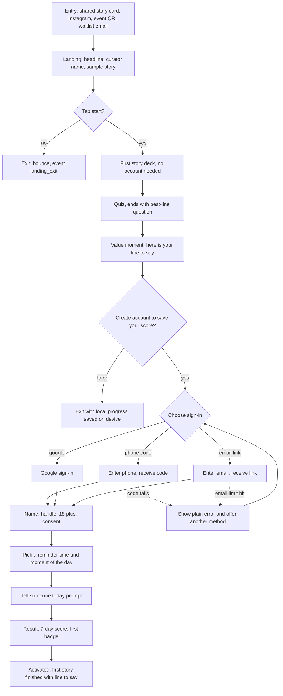
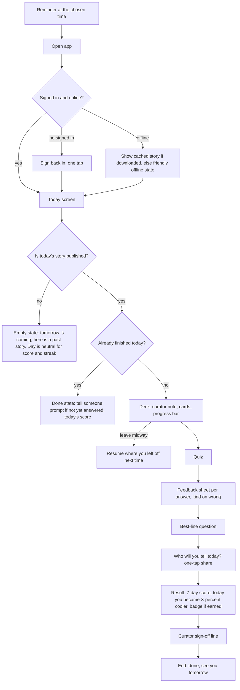
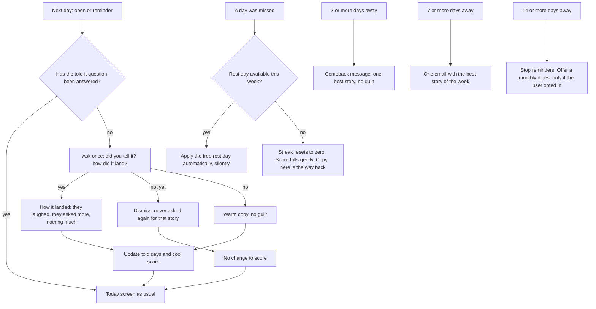
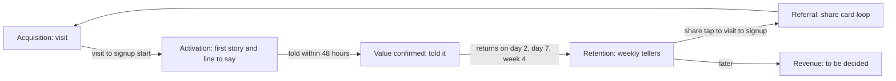

# Abstract: user flows, design principles, AARRR growth system, human curation, lifecycle

Checkpoint 6 (Deliver, part 2). Builds on `05-release-scope-and-prioritisation.md`. Flowcharts are written in Mermaid, which GitHub renders; if your viewer shows code instead, open the file on GitHub.

Labels: [Fact] sourced. [Hypothesis] untested. [Rec] my recommendation. Targets and thresholds are **not** invented here; they are calibrated later from the beta.

---

## 1. Flows overview

Four flows, in order of importance. Each shows entry, decisions, success, failure, empty and recovery states, plus the events that must fire (section 8).

1. **A. Acquisition to activation** (new person to first story and sign-up)
2. **B. The daily loop** (returning user, the heart of the product)
3. **C. The next-day loop and re-engagement** (told it, missed days, lapsed users)
4. **D. Settings, privacy and exit**

---

## 2. Flow A: acquisition to activation

[Rec] Show value **before** asking for an account. The first story is playable without signing in; sign-in is offered after the quiz to "save your score". Progress is kept in the browser until sign-in, then attached to the account. (Trade-off: a little more work; avoids the email-link wall we hit in our own test.)

**Friction and drop-off risks:** landing copy not landing; sign-in friction (Android on mobile data); asking for too much before value; the reminder permission asked too early.
**Success state:** first story finished and best-line answered (activation, section 9).
**Failure states:** sign-in code or email not arriving (offer an alternative method, never a dead end); age under 18 (stop politely, no retry loop on the same device).
**Empty state:** none for new users; a sample story always exists.

---

## 3. Flow B: the daily loop (returning user)

**Peak-end design.** The sequence is deliberate: learn, answer, **commit to telling**, **see the honest score and any badge (peak)**, **curator sign-off (end)**. The end is a human line, not a score.
**Friction and drop-off risks:** a story that runs past five minutes (Parkinson's Law: work expands to fill the time, so we cap it); the quiz feeling like an exam; the share prompt feeling like an ad.
**Failure and recovery:** save failures never lose the finished state (retry in the background, show a calm note); a swipe always has a button alternative; leaving a story keeps the user's place.

---

## 4. Flow C: next day, missed days and lapsed users

**Rules:** the next-day question is asked once and is never tied to the streak. A missed day never produces a message that says "you lost". After 14 days away we stop reminding, to avoid becoming spam.

---

## 5. Flow D: settings, privacy and exit

Reminder time and moment of the day; hide or show the score; badges shelf; about the curator and how stories are made; sign out; delete account and data (a confirmation step, then a clear "done" state, with what is removed listed in plain words); contact and feedback. Deleting an account is reachable in two taps from the profile (error prevention, user control).

---

## 6. Nielsen's ten heuristics applied to these flows

Patterns from Duolingo, CRED and Google Pay are listed as **transferable principles**, based on my general knowledge of those products. I did not research them in this session; verify during design.

| # | Heuristic | Concrete decision for Abstract | From the best apps (transferable) | Does not transfer |
|---|---|---|---|---|
| 1 | Visibility of system status | A progress bar in the deck and quiz; a saving indicator; every score number explains itself | Duolingo's lesson progress bar and feedback after each answer | Hearts and energy (anxiety, not status) |
| 2 | Match with the real world | Plain, lowercase, human words: "tell someone today", "rest day", not "share" or "freeze" | Google Pay's plain, confirmatory language | Fintech jargon |
| 3 | User control and freedom | Back and forward in the deck, leave and resume, dismiss the next-day question, hide the score, undo "told it" | Easy undo and cancel in payment flows | n/a |
| 4 | Consistency and standards (Jakob's Law) | Swipe cards, a bottom sheet for feedback, standard phone-code and Google sign-in, yellow always means the primary action | Familiar card and sheet patterns | Novel gestures with no payoff |
| 5 | Error prevention | Rest day applied automatically; double-submit guard; timezone-safe days; a confirmation before account deletion | Payment apps' confirm-before-irreversible steps | n/a |
| 6 | Recognition over recall | Today always shows the one next action; badges show how they were earned | Duolingo's single clear next lesson | Dense home dashboards |
| 7 | Flexibility and efficiency | One-tap share to the last app used; reminder presets; keyboard arrows on desktop | Google Pay's speed to complete a task | n/a |
| 8 | Aesthetic and minimalist design | One primary action per screen; no decoration that does not help retelling | CRED's confident, distinctive visual identity | A heavy rewards economy |
| 9 | Help recognise, diagnose and recover from errors | The error we saw in testing ("email rate limit exceeded") becomes: "the email service is busy. Try a phone code instead." with a button | Google Pay's clear failure states with a next step | n/a |
| 10 | Help and documentation | "How is this calculated?"; a short "how stories are made" page; contact | In-flow help rather than a manual | n/a |

---

## 7. Other behavioural principles applied (verified meanings in checkpoint 2)

| Principle | Concrete decision | How we would know it worked |
|---|---|---|
| Fitts's Law | Primary action bottom-centre within thumb reach, at least 48 px tall, never moves; share and "next" buttons large | Mis-tap rate; time to first tap on Today |
| Von Restorff effect | Only the "say it out loud" card is yellow; only the curator note is a distinct block; badges appear once, not constantly | Recall in interviews of "the line"; badge notice rate |
| Peak-end rule | Design the end as the curator's sign-off, after the score and badge (Flow B) | Day-2 return and interview sentiment about "how it ended" |
| Goal-gradient and Zeigarnik | Visible progress through a story; resume a half-finished story; 30, 90 and 365-day windows show "unlocks in X days" | Resume rate; return after leaving midway |
| Parkinson's Law | A hard five-minute ceiling; no infinite scroll after the story | Session length distribution; share finishing within five minutes |
| Gruen transfer (warning) | No disorienting layouts, countdown pressure, fake scarcity or manipulative streak-loss copy; the app has a clear end | Complaints; uninstall and opt-out rates; qualitative interview |

---

## 8. Events and data to instrument

Every event carries: user id (or anonymous id before sign-up), timestamp (UTC) and local day (IST or the user's timezone), app version, platform, story id where relevant, and acquisition source on the first event.

| Group | Event | Key properties |
|---|---|---|
| Acquisition | `landing_viewed`, `cta_clicked`, `signup_started`, `signup_completed`, `signup_failed` | source, method, error code |
| Activation | `story_started`, `card_viewed`, `story_finished`, `quiz_finished`, `best_line_answered` | story id, correct or not, time taken |
| Value and retelling | `share_tapped`, `told_it_prompt_shown`, `told_it_answered`, `how_it_landed_answered` | channel, answer |
| Score and progress | `score_viewed`, `score_explained_opened`, `cooler_moment_shown`, `badge_awarded`, `rest_day_applied`, `score_hidden_toggled` | window, value, badge id |
| Reminders | `reminder_permission_asked`, `reminder_permission_result`, `reminder_sent`, `reminder_opened` | channel, moment |
| Curation | `curator_note_opened`, `how_made_opened`, `contested_note_viewed` | story id |
| Health | `error_shown`, `offline_shown`, `account_deleted` | code |

**Privacy:** first-party only; no analytics SDK that sends reflections or phone numbers elsewhere; share cards carry no personal data. A single SQL view reports the metrics weekly.

---

## 9. AARRR growth system

**North-star outcome (hypothesis):** *Weekly Tellers*: the number of people who told at least one story to someone in the last 7 days. It measures the centre of the product (retelling), not just opens.
**Supporting principle:** meaningful engagement. More sessions without telling is not a win.

### 9.1 Funnel

### 9.2 Stage by stage

**Acquisition**
- *User goal and mindset:* curious but sceptical; "is this for me, is it worth five minutes?"
- *Product job:* show value and a human behind it in under 10 seconds, then let them try a story.
- *Key flow and features:* landing, the first story without an account (Flow A).
- *Friction:* generic copy; slow load on mobile data; asking for sign-up too early.
- *Metrics and definitions:* **Landing to signup start** = `signup_started` users ÷ unique landing visitors. **Signup completion** = accounts created ÷ `signup_started`. **Waitlist conversion** = accounts from the existing waitlist ÷ waitlist size. **Source mix** = accounts by source ÷ total accounts.
- *Events:* `landing_viewed`, `cta_clicked`, `signup_started`, `signup_completed`.
- *Measured:* daily, reviewed weekly, by source.
- *Experiments:* with versus without the human-curator claim; "daily" wording; hero photo versus none.
- *Guardrails:* share of signups that never open a story (traffic quality); load time.

**Activation**
- *Definition (real value):* **Activated = finished the first story and answered the best-line question within 24 hours of first arrival.** The user has received a line they can say; we do not call "opened the app" or "finished onboarding" activation. The stronger **Value confirmed** = told it "yes" within 48 hours of activation.
- *Metrics:* **Activation rate** = activated ÷ first-time visitors who started a story. **Time to first story** = median time from first load to `story_finished`. **Value confirmed rate** = value confirmed ÷ activated.
- *Friction:* sign-in wall; a deck that feels long; the quiz feeling like a test.
- *Experiments:* sign-in after the quiz versus before; deck length for the first story; the first quiz question.
- *Guardrails:* quiz skipping; abnormally short time to finish (rushing); drop at the sign-in step.

**Retention**
- *User goal:* a small reliable moment of feeling sharper.
- *Product job:* a trigger, a reason to open tomorrow, and a payoff that is useful with another person.
- *Metrics:* **Day-N return** = users who finished at least one story on calendar day N after signup ÷ the signup cohort (N = 1, 7, 14, 30). **Weekly retention** = users with at least one finished story in week W ÷ the signup cohort. **Weekly Tellers** (north star). **Weekend return** = share of weekend days finished among users active that week. Long-term cohorts: monthly (4, 12 weeks).
- *Does daily trivia actually deliver value or just sessions?* Compare retention and told-it rates between people who tell and people who do not. Caveat: correlation, not proof; the beta's random split (cooler moment, curator note) gives cleaner evidence.
- *Experiments:* reminder moment of day; the cooler moment on or off; curator note on or off; one rest day versus none.
- *Guardrails:* sessions per user with no told-it; reminder opt-out rate; unsubscribe; session length (should sit under the five-minute ceiling).

**Referral**
- *User goal:* share something good with the right person.
- *Product job:* make the share a natural part of retelling (R41).
- *Metrics:* **Share rate** = `share_tapped` ÷ `story_finished`. **Share to visit** = visits arriving from share links ÷ shares. **Visit to signup from shares** = signups ÷ those visits. **Viral coefficient** (hypothesis) = shares per user × share-to-signup rate.
- *Experiments:* card copy written by the curator versus a plain link; the share prompt wording.
- *Guardrails:* complaints about spam; share prompt dismissals.

**Revenue**
- *Status:* **no payment in Release 1** (decision on scope; business model D9 is open).
- *What we do now:* learn willingness to pay in the interviews; track clicks on links to Abstract events and community as the closest real revenue signal the founder has.
- *Options to assess later, not chosen:* tickets and membership to Abstract events attributed to the app; a paid collection or season led by guest curators; corporate culture packs; sponsorships (risk: trust conflict with the human-curation claim).
- *Metrics when relevant:* paying users ÷ retained users; revenue per retained user; event ticket sales attributed to the app.
- *Guardrail:* never put the daily story behind a paywall in a way that damages the retelling loop.

### 9.3 How observed behaviour informs the next iteration

| If we observe | We do next |
|---|---|
| Low landing to signup | Rewrite landing copy; test the curator claim; shorten the page |
| Low activation, high sign-in drop | Move sign-in after the quiz; add a phone-code option |
| Activation fine, low value confirmed | The quiz teaches but does not change behaviour: strengthen the tell prompt and retell cards |
| Told-it high, day-7 return low | The payoff is real but the cue is weak: change reminder moment and channel |
| Share rate high, signups low | Fix the landing the shares point to |
| Day-2 return low | Rework the end of the session and the next-day prompt |
| Opt-outs rising | Reduce reminders; review copy for guilt |

---

## 10. Human curation: where it shows and what workflow must exist

[Decision] A real human is visible. The curator is the founder for now.
[Rec] Show the human **in the content, not in a banner**. Marketing copy alone ("handpicked by humans!") will not be believed.

### 10.1 Where the human appears
- **On every story:** the curator's name and photo, and a two-line note: why I picked this, and what I could not confirm.
- **On contested claims:** an honest "contested" note on the card.
- **End of each session:** a sign-off in the curator's own voice.
- **A "how this story was made" page:** the real workflow, with a link to sources.
- **Guest curators and credited contributors**, so the product is a voice with other voices, not one person.

### 10.2 What the product may claim, and what must be true
| Claim in the app | Must be true |
|---|---|
| "Picked by [name]" | The named person actually chose the topic |
| "Checked against two sources" | The check log shows two sources, one primary, for each claim |
| "Checked by someone other than the writer" | An independent named checker signed it (needs the part-time editor hire) |
| "AI helps us deliver and personalise" | AI is used only for delivery, formatting, source gathering, drafting quiz options or personalisation; a named person does the choosing, verifying and signing |

### 10.3 The workflow behind it
1. **Scout:** the curator picks and records why.
2. **Source:** two sources per claim, one primary, recorded.
3. **Draft:** story and quiz drafted. AI may summarise sources and draft wrong-answer options; a human rewrites.
4. **Check:** a named person verifies every claim. [Rec] Until a second person exists, the founder is writer, curator and checker, so the app says only "checked by [name]" and **never** "independently checked".
5. **Sign:** the curator writes the note and signs.
6. **Schedule and publish** from a buffer of at least 21 stories.
7. **Correct:** a visible correction notice and a way to retract a story (a retraction removes it from clients immediately).

### 10.4 Where human involvement adds friction (avoid)
Do not put a long editorial block before the story. Keep the human to a two-line note, a sign-off and an optional "how this was made" tap.

---

## 11. Product lifecycle and delivery roadmap

| Stage | Deliverables | Decisions required | Dependencies | Responsible | Exit criteria | Measurable outcomes |
|---|---|---|---|---|---|---|
| **1. Conceive and plan** | Audit, discovery, persona and JTBD, strategy (checkpoints 1 to 4) | D1 to D4 (done), D5 platform, D6 sign-in | Founder time | Founder, this PM role | Direction approved; open decisions listed | n/a |
| **2. Define and prioritise** | Release 1 scope, MoSCoW, flows, acceptance criteria, AARRR, instrumentation plan (checkpoints 5 and 6) | D5, D6, D7 (confirmed: score and badges only), D9 timing | Stage 1 | Founder, PM | Founder signs off the scope and criteria | Acceptance criteria agreed |
| **3. Build** | Rewrite the app to the new direction: retell-first, curator note, score, badges, reminders, instrumentation; the 21-story content buffer; fact-check workflow; privacy basics | Final sign-in, reminder channel, copy | Stage 2; the hires from checkpoint 1 section 8 | Engineer, writer, fact-checker, designer, founder as curator | All 20 acceptance criteria pass; 21 checked stories exist | Criteria passed; defects |
| **4. Test and launch** | Usability tests (5 to 8 people), a closed beta of about 100 waitlist members for 14 days, launch checklist | Beta thresholds frozen before opening | Stage 3 | Founder, engineer | Pre-agreed beta gates read out; no severity-1 defects | The beta metrics in section 9 |
| **5. Measure and refine** | Cohort analysis, interviews with beta users, experiment backlog, a prioritised iteration | What to fix, promote, or drop | Beta data | PM, engineer | A clear continue, change or stop decision | Retention and told-it trends |
| **6. Scale** | Public launch, native wrap if justified, Tonight mode, referral mechanics, crews or pair retell, revenue exploration | Business model (D9), expansion | Stage 5 retention is repeatable | Founder, growth, engineer | Retention and told-it hold across at least two cohorts; content engine sustains | Cohort stability; cost per story; sustainable hours |

---

## 12. Decisions still needed from you

1. **D5 platform:** approve "installable web app first, native later", knowing iOS reminders need a home-screen install. (My recommendation, section 5 of checkpoint 5.)
2. **D6 sign-in:** I recommend phone code and Google, with email as a fallback, and value shown before sign-up. Is a phone-code cost acceptable? (An SMS provider and India's registration rules are not yet researched.)
3. **Reminder channel:** web push and email first, WhatsApp only if the cost and rules work. Approve?
4. **Who is the fact-checker** for Release 1, and when? (Until then the app cannot say "independently checked".)
5. **Beta gates:** set the thresholds with me before the beta opens, from the first interviews.
6. **Business model (D9):** when do you want to open it? My advice: after the beta.
