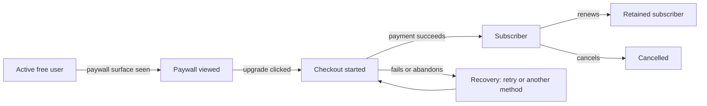
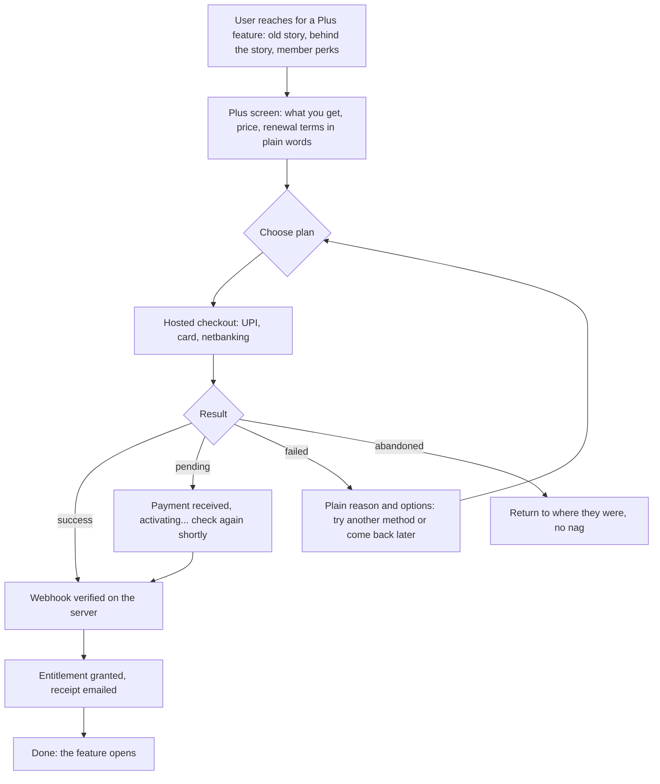
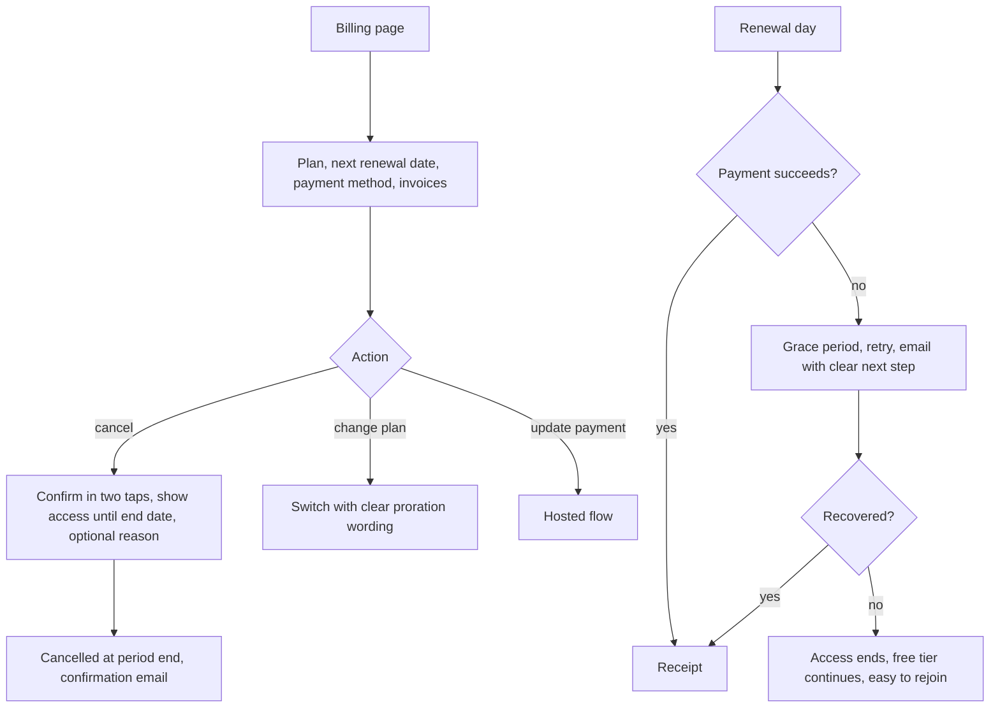

# Abstract: monetisation and public launch (addendum to checkpoints 5 and 6)

Checkpoint 7. Two founder decisions change Release 1:

1. **Revenue is part of this phase.** Payment integration is required for the next submission, and the model is **freemium**: part of the product free, a paid layer on top. Exact pricing is decided later.
2. **This is a public launch, not a closed beta.**

This document replaces the "no payment" and "closed beta" assumptions in `05-release-scope-and-prioritisation.md` and `06-flows-and-growth-system.md`. Where they conflict, this one wins.

Labels: [Fact] sourced. [Decision] founder decided. [Hypothesis] untested. [Rec] my recommendation. I give **no prices and no conversion targets**; we have no baseline to calibrate from.

---

## 1. Pushback first, because the stakes went up

1. **Charging before value is proven is a bet, not a plan.** We still have no real user evidence that people return daily or retell. A paywall adds a second thing we have to get right at the same time. [Rec] Do it, because it is decided and the submission needs it, but keep the paid layer **cheap to produce** and **never** touch the daily promise.
2. **No beta means no safe place to learn.** A public launch gives users the product before we know whether the core loop works. [Rec] Replace "closed beta" with a **staged public launch** (section 3) so we still get a measurement window and a way to stop.
3. **The founder is now content, curator, checker, support, refunds and tax.** [Fact] From checkpoint 1: 42 to 70 hours a week for the stories alone. Payments, support and compliance sit on top. This is the biggest threat to the launch and it is a people problem, not a product one.
4. **"A layer after that" is ambiguous.** I read it as: a free tier, then a paid tier above it. If you meant something else, tell me.

---

## 2. Freemium design

### 2.1 Principles (the ruthless part)
1. **Never paywall the daily promise.** Today's story, the quiz, "tell someone", the next-day question, the cool score, the streak and the badges stay free. Reason: retelling is the centre of the product, free users power sharing and word of mouth, and a paywall around the human-curated story would undermine the trust claim.
2. **Sell depth, convenience and belonging, not relief from invented pain.** [Fact] Duolingo's paid tier (Super) removes ads and the "hearts" limit and adds practice and offline features ([overview](https://www.desarrollolibre.net/blog/programacion-basica/super-duolingo-the-free-language-learning-app-review), a low-quality secondary source). That is a pattern to learn from, not copy. We will **not** build hearts or energy, and we will **not** sell streak repair or score boosts: charging people to remove guilt we created is the manipulation we ruled out.
3. **No ads.** Ads conflict with the human-curation trust claim and need scale we do not have.
4. **Never interrupt the loop or its ending.** The paywall appears only where the user reaches for something extra, never mid-story, never on the result screen (the peak-end design in checkpoint 6 stays clean).
5. **Everything we charge for must exist when we charge for it.** We sell what is delivered, not a roadmap. If we offer "founding member" pricing, we state exactly what it includes today.

### 2.2 Proposed free and paid lines (hypotheses)

Placeholder tier name: **free** and **plus** (to rename in the Abstract voice).

| Capability | Tier | Why | Cost to deliver |
|---|---|---|---|
| Today's story, quiz, tell-it share, next-day question | **Free** | The promise and the growth loop | Already planned |
| Cool score (all four windows), streak, 12 badges, reminders | **Free** | The habit; paywalling it punishes retention | Planned |
| Curator note on every story | **Free** | The human claim must be visible to everyone | Minutes per story |
| Last 7 days of past stories | **Free** | Lets free users catch up | Planned |
| **Full archive and search** | **Plus** | Convenience for heavy users | Low |
| **Behind the story** (full source notes, what the curator cut, rabbit-hole links) | **Plus** | Depth for the curious; reuses output we already produce for fact-checking | Low |
| **Abstract member perks** (early access or discount on events, a member-only space, a monthly note from the curator) | **Plus** | The strongest brand-native value; real-world belonging | Medium, depends on events operations |
| **Tonight mode** (pick an occasion, get three stories and openers) | **Plus** | High-intent moment | Medium; needs a tagged library |
| **Guest-curator seasons and themed packs** | **Plus** | Variety and the "guest curators" asset | High per pack; uses guest effort |
| **Repertoire with gentle reminders** | **Plus** (later) | Long-term memory | Medium to high |
| **Voice rehearsal** | **Plus** (later) | Practising out loud | Medium |
| Offline packs | **Plus** (later) | Convenience | Medium |
| Gift a month to a friend | Revenue and referral (later) | Natural referral | Low to medium |
| Streak repair, score boosts, hearts, ads | **Never** | Manipulative | n/a |

### 2.3 What can honestly ship in Release 1
[Rec] The paid layer in Release 1 should be what is **cheap and real on day one**:
1. **Full archive and search** (thin at launch: with about 21 stories the archive is small, so be honest about it).
2. **Behind the story.**
3. **Abstract member perks**, delivered by hand where needed (for example a member code for events).
4. **Founding member status**, if you want it: a limited early price for people who join at launch, stating exactly what is included. It brings cash and willingness-to-pay data before the paid layer is deep. This is a founder decision (see section 10).

Tonight mode and seasons are **Should** and follow once the library and guest-curator capacity exist.

### 2.4 Where the paywall appears
- Tapping a story older than 7 days; tapping "behind the story"; tapping a Plus-only entry such as Tonight mode; the settings and profile page; an optional, quiet mention of Plus after the user has been active a while.
- Never: inside the daily loop, on the result screen, or in notifications as a nag.

---

## 3. Public launch: staged, with gates

[Rec] **Stage the public launch** so we keep a learning window and a way to stop. This replaces the closed beta.

| Stage | Who | Purpose | Move on when |
|---|---|---|---|
| **0. Final checks** | The team and 10 to 20 trusted people | Catch severe defects; test a real payment end to end | Gates in 3.1 all pass |
| **1. Soft public launch** | The existing waitlist and the founder's community channels, announced openly | Real users, real payments, controlled volume | No severity-1 defects; payments and sign-in stable; first-week metrics read without surprises |
| **2. Wider launch** | Public, paid acquisition or press only after stage 1 | Scale | The metrics gates set in advance hold |

The random splits we planned for the beta (cooler moment, curator note) can still run on live traffic.

### 3.1 Non-negotiable launch gates
1. The content buffer is ready: at least 21 finished, checked stories, and a plan to keep it from running out.
2. Payments work end to end in live mode, including failure, refund and cancellation paths (section 5).
3. Privacy notice, consent, terms, refund policy, and account deletion are live and linked.
4. Sign-in works on Android over mobile data with a fallback (our own test failed on email; the email service limit must be solved before launch).
5. Monitoring and a **kill switch**: we can stop signups, stop charging, or hide a story within minutes.
6. A support channel and a named person who answers it within a stated time.
7. The metrics and events from checkpoint 6 are instrumented, plus the revenue events in section 6.
8. Legal and tax review done for the points in section 5.4.

### 3.2 What public launch changes in our plan
- "Beta exit criteria" become **launch gates** (above) and a **30-day read** with thresholds fixed before stage 1.
- Moderation and abuse risk is low for now because crews and community feeds are out of scope.
- Support, refunds and failed payments now exist as real operational work.

---

## 4. Pricing approach (no numbers yet)

[Decision] Exact pricing later. How I would get there:
- **Structure to build now, so price can change without code:** monthly and annual plans, a highlighted annual default, an optional founding-member plan, and a price stored in configuration, not in the code.
- **Research (cheap, before launch):** add price questions to the real interviews: at what price is it so cheap you doubt it, a bargain, getting expensive, too expensive (a Van Westendorp-style set), and what they would give up (checkpoint 2, question 11).
- **At launch:** test prices on **sequential cohorts** (not different prices to people at the same time) and record the results. Do not guess.
- **Anchor on value delivered to the person, not on Duolingo.** [Fact] Duolingo's subscriptions are roughly 9 percent of its monthly users in recent filings reported by secondary sources ([octagonai summary](https://www.octagonai.co/markets/financials/kpis/duolingo-paid-subscribers-in-fiscal-2026/), prediction-market page, treat as indicative at best). That is a different product, scale and market, so I **do not** assume anything like it for us.
- **Position the price with the human:** "your subscription pays the people who find and check these stories". This is truthful and links paying to the differentiator.

---

## 5. Payments: stack, flow and compliance

### 5.1 Recommended stack (hypothesis, to confirm with the provider)
- **Gateway:** Razorpay (Checkout plus Subscriptions) or an equivalent Indian gateway. [Fact] Razorpay documents UPI AutoPay recurring payments; for regular merchant categories, a later debit above ₹15,000 needs the user to approve with their UPI PIN, and the limits are set by NPCI by merchant category ([Razorpay docs](https://razorpay.com/docs/payments/payment-gateway/s2s-integration/recurring-payments/upi)). A secondary source claims higher no-approval limits for some categories; **check with Razorpay for ours**.
- **Web payments only for now.** An installable web app (checkpoint 5) takes payment on the web, so no app-store billing. [Fact] If we later wrap a native app, Google Play's billing rules apply to in-app digital content, with a user-choice-billing option in India as of 2023-era reports ([Inc42](https://inc42.com/?p=385742)); I did not verify current terms. Apple's rules would also need checking. **Do not wrap the app for the stores until we have reviewed both.**
- **Card data:** use the gateway's hosted checkout so card details never touch our servers.

### 5.2 How entitlements work (architecture)
1. The user starts checkout. The gateway handles payment.
2. The gateway sends a **webhook** to a server function. The function verifies the **signature**, writes the subscription record, and grants the entitlement. The client is **never trusted** to say "I paid".
3. The webhook is **idempotent** (a repeated event changes nothing) and handles out-of-order events.
4. The app reads the entitlement from the server. If the webhook is delayed, the user sees "payment received, activating", not an error.
5. Failed renewals follow a **grace period** and a few retries before access ends (dunning), with clear emails.
6. Cancellation takes effect at the end of the paid period; refunds remove access per the refund policy.
7. Test and live keys are separate; secrets live only on the server.

[Fact] This codebase currently has **no server logic** (the web app talks to Supabase with row-level security from the browser). Payment webhooks need a server function (for example a Supabase Edge Function). That is new work.

### 5.3 The submission
[Rec] **Build the full payment flow in the gateway's test mode first.** It is demonstrable and safe. **Live mode needs the gateway's business account to be activated** (business verification and bank details), which has a lead time I do not know. **Start that process now.** I need to know whether your submission needs live money or a working test-mode flow (section 10).

### 5.4 Compliance checklist (flag for an accountant and a lawyer; I am not either)
- **GST.** [Fact] Sources describe 18 percent GST on online (OIDAR-type) services, a ₹20 lakh registration threshold for domestic providers, and a no-threshold rule for foreign providers ([Treelife](https://treelife.in/legal/oidar-registration-in-india/), consultancy blog; one source disputes the scope). **Confirm with your accountant** how the company registers, what rate applies to this subscription, and how invoices are issued. Show prices inclusive of tax and send invoices.
- **Recurring payments.** Card subscriptions in India follow RBI's e-mandate rules (authentication at setup, notice before each debit); UPI AutoPay has its own mandate limits (above). I have not verified the current rules. **Confirm with the gateway.**
- **Consumer terms.** Clear price, clear renewal date, **easy cancellation in the app**, a written refund policy, terms of service, a privacy notice. Treat as launch gates.
- **Receipts and records.** Keep payment records for the retention period your accountant states.
- **18+.** Already required. Payments from minors are excluded by the age gate.

---

## 6. Revenue in AARRR (the full stage)

**User goal and mindset:** a regular user wants more of what already helps them (depth, convenience, belonging); they are happy to pay if the free product has proved itself and the price feels fair.
**Product job:** make the upgrade obvious at the right moment, make paying effortless and safe, and make leaving easy and respectful.

### 6.1 Funnel

### 6.2 Metrics (definitions and denominators)
**Active user** for revenue purposes = a user who finished at least one story in the trailing 30 days.

| Metric | Definition | Denominator |
|---|---|---|
| Paywall view rate | Users who saw any paywall surface | Active users |
| Upgrade click rate | Users who clicked upgrade | Users who saw a paywall |
| Checkout completion | Successful first payments | Checkouts started |
| **Free to paid conversion** | New paying subscribers in a period | Active free users at the start of that period |
| Payment success rate | Successful payments (first and renewal) | Payment attempts |
| Subscriber retention | Subscribers renewing at month 1, 3, 12 | Subscribers in that start cohort |
| Voluntary and involuntary churn | Cancellations vs failed-payment lapses | Subscribers at period start |
| Revenue per active user | Revenue | Active users |
| Revenue per paying user | Revenue | Paying users |
| Refund rate | Refunds issued | Payments |
| Failed-payment recovery | Recovered renewals | Failed renewals |
| Paid layer use | Subscribers using at least one Plus feature in 30 days | Subscribers |

I set **no targets**. Calibrate from the staged launch.

### 6.3 Events to add
`paywall_viewed` (surface), `upgrade_clicked` (plan), `checkout_started`, `payment_succeeded`, `payment_failed` (code), `subscription_started`, `entitlement_granted`, `renewal_succeeded`, `renewal_failed`, `grace_period_started`, `cancellation_started`, `cancellation_completed` (reason), `refund_requested`, `refund_issued`, `plus_feature_used` (feature), `billing_page_viewed`.

### 6.4 Experiments
Which paywall surface converts without hurting retention; annual default vs monthly default; founding-member offer vs none; price (sequential cohorts); wording tied to the human ("pays the people who find and check these stories"); gift later.

### 6.5 Guardrails (so we do not buy revenue with retention)
- **Day-7 return and told-it rate of free users after the paywall appears** must not fall compared with users who have not seen it.
- Refund rate, support tickets and cancellation reasons.
- Reminder opt-outs and uninstalls after a paywall view.
- Time to cancel (it must stay short; no dark patterns).
- Share of Plus users who stop telling stories (paid should not break the centre of the product).

---

## 7. Flows

### 7.1 Upgrade, payment and failure

### 7.2 Manage, cancel, renew

Never block the free product because a payment failed.

---

## 8. Changes to Release 1 (replacing parts of checkpoint 5)

**New Musts:** payment integration (test, then live), entitlements and webhooks, a Plus screen and contextual paywall surfaces, billing page (view, change, cancel), receipts and invoices, refund policy and terms, tax handling, the paid layer in 2.3, revenue events and metrics, a support channel, a kill switch.
**Moved from Won't to Must:** subscription or payment.
**Unchanged Wont's:** gems, quests, leaderboards, crews, chat, recalls and ownership, animated character, native store apps.

### New acceptance criteria (added to the 20 in checkpoint 5)
21. A user can pay from an Android phone with UPI and with a card, in the gateway's test mode, and the paid features unlock only after the server confirms the payment.
22. If the confirmation is delayed, the user sees "activating", and the feature opens when the webhook arrives, without paying twice.
23. A failed or abandoned payment returns the user to where they were with a plain explanation and a way to try again. It never locks the free product.
24. A duplicate webhook does not create a duplicate subscription or a double grant.
25. The user can see their plan, price including tax, next renewal date and invoices, and can cancel in the app in two taps. Access continues to the end of the paid period.
26. A renewal failure follows the grace period and retry rules and tells the user clearly.
27. Refunds can be issued and remove access as the refund policy states.
28. No paywall appears inside the daily loop or on the result screen. The daily story, quiz, tell-it, score, streak and badges are free for everyone.
29. Test and live keys are separate, and no secret is in the browser.
30. Prices are stored in configuration so they can change without a code release.
31. Launch gates in 3.1 all pass before stage 1.

---

## 9. Plan impact

- Add requirements for the paid layer, entitlements, billing, and the revenue events to the Direction update (done in the plan).
- Checkpoint 5's "closed beta" wording and "won't have payments" row are superseded by this document.
- The plan's units need a new unit for payments and entitlements, and U12 gains the launch gates. Done in the build checkpoint.

---

## 10. Decisions and information I need from you

1. **The submission:** by when, and does it need **live** payments or a working **test-mode** payment flow? This sets the plan.
2. **Approve the free and paid line** in 2.2 and the Release 1 paid layer in 2.3, or tell me what to move.
3. **Founding member offer** at launch: yes or no?
4. **Gateway and business readiness:** is there a registered business entity, bank account, and GST status the gateway can verify? Who owns that account?
5. **Public launch date**, and does the staged ramp in section 3 work for you?
6. **Who handles support and refunds** at launch?
7. **Names** for the free and paid tiers (I used placeholders).
